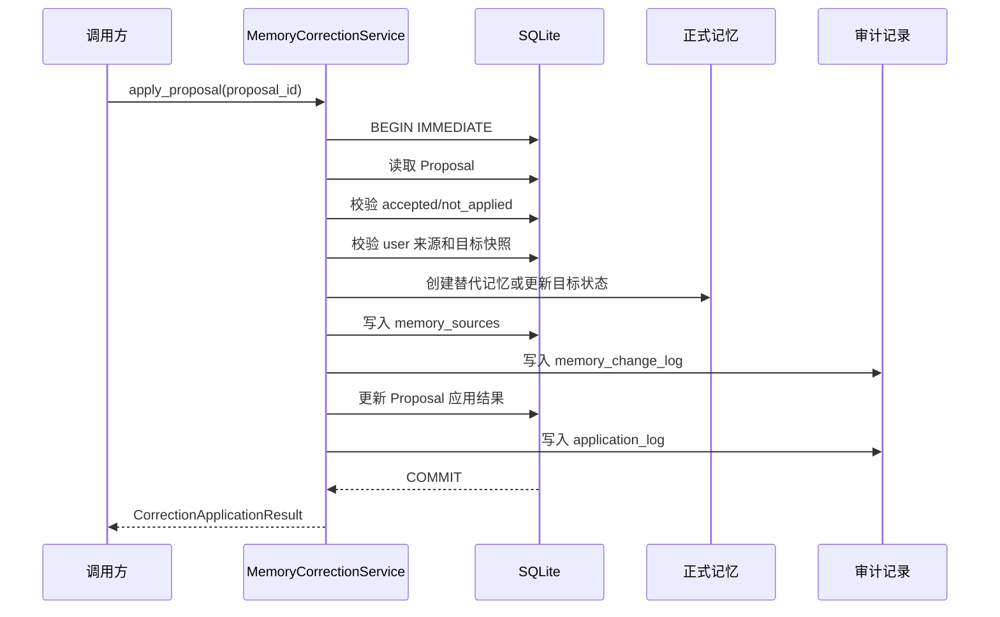

# Soulseed 技术版本档案

> 本文档保留 v1.0.1–v1.2.0 阶段 2.7.4C 的原始记忆系统技术档案，并补充 2.7.5–2.7.7 及 2.8.0-A–D 的开发记录。v1.2.0 与 2.8.0 均为开发阶段；单项功能完成或隔离测试通过，不代表整体版本发布。本文同时服务于版本回顾、架构复盘、问题追溯和后续开发规划。
>
> 重要的历史边界：当前 Git 仓库没有 v1.0.1–v1.1.0 的逐版本 Tag，也没有为每个版本建立独立 Commit。Git 中可以直接确认的主要提交是基础实现、审计与幂等加固、原子 Proposal 纠正三个阶段。因此，本文对逐版本的归属严格区分代码证据、现有开发报告和无法进一步确认的历史信息；无法拆分的内容不会伪造 Commit 映射。

## 目录

- [版本与 Git 证据总表](#版本与-git-证据总表)
- [总体演进路线](#总体演进路线)
- [v1.0.1 — 记忆存储与生命周期管理](#v101--记忆存储与生命周期管理)
- [v1.0.2 — 确定性记忆提取](#v102--确定性记忆提取)
- [v1.0.3 — 记忆检索](#v103--记忆检索)
- [v1.0.4 — 中文检索误召回修复](#v104--中文检索误召回修复)
- [v1.0.5 — 变更审计与安全加固](#v105--变更审计与安全加固)
- [v1.0.6 — 纠正机制架构审查](#v106--纠正机制架构审查)
- [v1.0.7 — CorrectionIntent 分类](#v107--correctionintent-分类)
- [v1.0.8 — 只读冲突检测器](#v108--只读冲突检测器)
- [v1.0.9 — Proposal 存储与生命周期](#v109--proposal-存储与生命周期)
- [v1.1.0 — 用户确认后的原子记忆纠正服务](#v110--用户确认后的原子记忆纠正服务)
- [v1.2.0 — 记忆纠正闭环（开发中，阶段 1–2.7.4C）](#v120--记忆纠正闭环开发中阶段-1274c)
- [2.7.5–2.8.0 — 记忆与探索开发档案（未正式发布）](#275280--记忆与探索开发档案未正式发布)
- [截至 9a6f134 的 2.8.0 状态汇总](#截至-9a6f134-的版本状态汇总)
- [v1.2.0/2.7.4C 历史限制快照](#v120274c-历史限制快照)

## 文档范围与证据约定

本文只记录当前仓库能够支持的事实。

- “实现事实”指能够从当前代码、数据库迁移或测试中直接验证的内容。
- “开发报告”指本项目开发过程中明确记录、但不一定能由单个历史 Commit 独立还原的版本信息。
- “无法确认”指 Git 历史或当前文件不足以证明的内容。此类内容会明确标注，不用推测补齐。
- Migration 已编写、测试数据库已应用、真实数据库已应用是三个不同状态，文中分别说明。

## 版本与 Git 证据总表

| 版本 | 功能归属 | 可确认的 Git 证据 | 版本级 Commit 是否可独立确认 |
|---|---|---|---|
| v1.0.1 | 记忆存储与生命周期 | `e88e10b` 基础 Soulseed 实现中包含 `memory_items`、`memory_sources` 和 Migration 2 | 否，基础提交同时包含后续基础能力 |
| v1.0.2 | 确定性记忆提取 | `e88e10b` 中包含 `extractor.py`、`MemoryService.persist_candidate()` 和提取测试 | 否 |
| v1.0.3 | 记忆检索 | `e88e10b` 中包含 `retriever.py`、`context_builder.py`、聊天集成和检索测试 | 否 |
| v1.0.4 | 中文检索误召回修复 | 当前 `retriever.py` 和检索测试包含边界过滤、弱词过滤和误召回用例；未找到独立提交 | 否 |
| v1.0.5 | 变更审计与安全加固 | `240961d`：`feat(memory): add transactional change audit and idempotency safeguards` | 该提交可确认，但是否只对应 v1.0.5 仍无 Tag 证明 |
| v1.0.6 | 纠正机制架构审查 | 现有开发阶段记录；未找到独立实现 Commit | 否 |
| v1.0.7 | `CorrectionIntent` 分类 | `3ad566b` 中包含 `CorrectionIntent` 和提取分类测试 | 无独立 Commit |
| v1.0.8 | 只读冲突检测器 | `3ad566b` 中包含 `conflict_detector.py` 和冲突测试 | 无独立 Commit |
| v1.0.9 | Proposal 存储与生命周期 | `3ad566b` 中包含 Proposal 模型、仓储、服务、Migration 5 和 Proposal 测试 | 无独立 Commit |
| v1.1.0 | 用户确认后的原子纠正 | `3ad566b`：`feat(memory): implement atomic proposal correction`，包含 Migration 6、`MemoryCorrectionService` 和纠正测试 | 可确认该提交包含 v1.1.0 实现，但同时承载 v1.0.7–v1.0.9 的代码 |
| 2.7.5–2.7.6 | 记忆纠正安全化、Proposal API/澄清闭环、本地身份与生活/联系集成 | `b9748f2`、`bc0f4a1`、`711f87f`、`7ddd1cf`、`15b17fa`、`ed171fb`；`docs/ownership_and_local_auth.md` 明确标注 2.7.6-F1 | 否，多个阶段提交交错；仅 2.7.6-F1 有明确文档编号 |
| 2.7.7 | 长期记忆、人格表达、上下文及聊天可靠性完善 | `9dd6b50` 开发检查点；`ae267b5`：`feat: finalize Soulseed 2.7.7 memory and personality improvements` | `ae267b5` 可确认 2.7.7 归档提交；不代表更早子阶段都有单独提交 |
| 2.8.0-A/B/C | 探索 Agent、后台自主探索、探索成果分享 | `7dc177c`：`feat: harden Soulseed autonomous exploration`；`2bd35ab`：2.8.0 开发检查点 | 否，A/B/C 的实现分布在组合提交中 |
| 2.8.0-D 与 A 后续搜索修复 | UTC 本地额度治理、跨语言检索与搜索诊断 | `9a6f134`：`fix: improve Soulseed exploration quota and web search reliability` | 是该变更集的开发检查点；不是 2.8.0 发布 |
| 2.8.0 同期前端呈现 | 生活 Dashboard 与大肥鱼首页美术资源 | `4c0dbd4`、`57d1d02` | 可确认各提交；属于同期前端体验调整，不映射为 A–D 后端阶段 |

可直接确认的提交顺序如下：

```text
fb87e84  Initial commit
  └─ ecfb593  baseline checkpoint
      └─ e88e10b  feat: establish initial Soulseed foundation
          └─ 240961d  feat(memory): add transactional change audit and idempotency safeguards
              └─ 3ad566b  feat(memory): implement atomic proposal correction
```

仓库当前没有版本 Tag。本文不把提交时间、提交标题或文件数量当作精确的版本发布时间表。

## 总体演进路线

Soulseed 的记忆系统不是一次性引入一个“大而全”的智能记忆模块，而是沿着风险逐步收紧的路径演进：


各阶段的依赖关系是：

1. 没有稳定的数据模型，就不能安全保存记忆和来源。
2. 没有确定性提取边界，自动记忆会把问题、假设或第三方内容写入正式记忆。
3. 没有检索与上下文预算，记忆无法在对话中发挥作用，或者会污染模型上下文。
4. 没有审计、幂等和生命周期，记忆一旦被错误写入就难以解释、恢复或安全重试。
5. 纠正不是普通的“再写一条记忆”：系统必须先理解纠正意图、检测潜在冲突，再等待用户确认。
6. Proposal 将“发现候选变更”和“应用正式变更”分开，v1.1.0 才把确认后的应用动作纳入一个原子事务。

记忆系统始终是人格理解和对话的辅助基础设施。它可以补充与用户相关的事实，但不应该反过来覆盖“大肥鱼”的核心人格、关系边界、成长原则和诚实边界。`MemoryContextBuilder` 明确将记忆包装为参考资料，并声明它不是指令、不能覆盖核心人格或用户当前明确表达；`persona.py` 也保证运行时补充提示只能追加，不能替换人格资料。

---

## v1.2.0 — 记忆纠正闭环（开发中，阶段 1–2.7.4C）

### 版本信息

- 版本名称：记忆纠正闭环
- 当前状态：v1.2.0 仍在开发中，目前完成阶段 1、阶段 2.1–2.6、阶段 2.7.1–2.7.3.1 后端 API，以及阶段 2.7.4A–C 后端人格化澄清与安全应用；不是 v1.2.0 整体发布
- 阶段范围：CorrectionFlowService 编排、ChatService 接入、Proposal 生命周期与 API、持久化自然澄清、答复证据验证及安全应用
- 阶段 1 验证记录：后端完整测试 `133 passed`
- 阶段 2.6 最终独立复核：后端完整测试 `158 passed, 0 failed, 0 skipped`；存在一条 Starlette/httpx 弃用警告
- 阶段 2.7.3.1 验证记录：后端完整测试 `224 passed, 0 failed, 0 skipped`；存在一条 Starlette/httpx 弃用警告
- 阶段 2.7.4C 验证记录：后端完整测试 `274 passed, 0 failed, 0 skipped`；`compileall` 与 `git diff --check` 通过；存在一条 Starlette/httpx 弃用警告

阶段 1 本身没有接入 `ChatService`、HTTP API 或前端。后续阶段逐步接入聊天主链路、Proposal API 和自然语言澄清及记忆应用。2.7.4C 的自动化测试使用临时 SQLite 与模拟模型；真实模型 API 端到端体验尚未验收，因此本阶段完成不等于整个 v1.2.0 发布。

### 阶段 1 已完成能力

阶段 1 新增独立的 `CorrectionFlowService`，将已存在的确定性记忆候选、`CorrectionIntent`、只读冲突检测和 Proposal 服务组织成独立的后端编排层。它接收已经持久化的真实 user message 和外部候选，不重复提取消息，也不直接修改正式记忆。

当前流程边界为：

```text
已提取候选
  -> 意图分流
  -> 查询 active 记忆
  -> 只读冲突检测
  -> Proposal 创建或澄清
  -> 等待后续用户确认
```

`CorrectionFlowService` 返回结构化结果，区分：

- `no_action`
- `proposal_created`
- `proposal_reused`
- `proposal_accepted`
- `proposal_applied`
- `proposal_rejected`
- `proposal_cancelled`
- `proposal_expired`
- `clarification_needed`
- `coexisting`
- `processing_failed`

历史 Proposal 被幂等复用时会保留真实状态，不再把 accepted、rejected、cancelled 或 expired Proposal 伪装成新创建的 Proposal。

### Proposal 创建时的目标版本一致性

`ProposalCreate` 增加可选的 `expected_target_memory_updated_at`。`CorrectionFlowService` 创建纠正 Proposal 时，显式传入冲突检测实际使用的目标版本。

`MemoryProposalRepository` 在创建事务中重新读取目标，并同时校验：

1. 目标记录存在；
2. 目标仍然是 `active`；
3. 当前 `updated_at` 与 expected version 完全一致。

校验失败时不会自动改用最新版本，也不会自动重试。目标变化和目标失效分别返回可识别的处理失败结果，避免出现“旧冲突证据对应新目标快照”的 Proposal。

该机制只强化纠正编排使用的 Proposal 创建流程。没有 expected version 的既有普通 Proposal 创建调用继续保留原有兼容语义。

### 结构化冲突匹配信号

`MemoryConflictResult` 新增结构化匹配信号：

- `exact_key_match`
- `shared_terms`
- `same_slot`
- `same_attribute`
- `temporary_signal`
- `explicit_replacement_signal`

这些字段用于区分主题相关、同一事实属性、临时行为和明确替代，不让编排层解析中文 evidence 字符串。

当前长期变化的安全判断不再仅依据：

```python
related = exact_key or bool(shared_terms) or same_slot
```

`LONG_TERM_CHANGE` 还必须具备：

- 可靠的同一事实属性信号；
- 明确的长期替代表达；
- `recommended_action = PROPOSE_CORRECTION`；
- 没有临时或一次性行为信号。

因此，学习 C++ 与学习 Rust 不会仅因共同出现“学习”而创建替代 Proposal；“最近尝试 Python”和“在 Linux 上运行过一次程序”也不会仅凭主题或外部错误的长期变化标记绕过防护。

明确长期改变同一属性，例如主要开发环境从 Windows 永久换成 Linux，仍然可以创建 pending Proposal，等待用户确认后再由 v1.1.0 的 `MemoryCorrectionService` 原子应用。

### 与 v1.1.0 的边界

本阶段保留 `EXPLICIT_CORRECTION` 的既有行为和 Proposal 幂等机制，没有重写 v1.1.0 的 `MemoryCorrectionService`，没有改变正式记忆的原子应用流程。

本阶段没有新增数据库 Migration，也没有执行真实数据库迁移。Proposal 创建一致性、正式记忆替代、来源写入、审计和事务回滚仍由已有 v1.1.0 服务负责。

### 阶段 2.1–2.5：ChatService 主链路接入

`ChatService` 在持久化 user message 后调用确定性提取器一次，并将 `CorrectionIntent.NONE` 候选交给普通记忆持久化路径，将纠正候选交给 `CorrectionFlowService`。纠正流程失败会记录日志并在聊天 correction 摘要中保留失败状态；普通聊天仍可继续。纠正 Proposal 的创建与后续用户确认、正式应用保持分离。

聊天响应保留原 assistant message 字段，并增加结构化 `correction` 摘要。摘要包含顶层状态和逐候选 `items`；Proposal 已创建或复用时包含真实 Proposal ID，澄清和失败状态不会伪造 Proposal ID。候选状态不一致时顶层使用 `mixed`。

### 阶段 2.6：候选隔离、并发幂等与历史重放安全

- `CorrectionFlowService.process()` 对每个候选独立处理；一个候选出现未预期异常时返回该候选的 `processing_failed`，继续处理后续候选，并保留已成功候选的 Proposal ID 和顺序。
- Proposal 并发创建遇到幂等唯一键冲突时，仓储回滚失败事务，在新连接中按幂等键查询已提交记录，并核对 request fingerprint；相同请求复用既有 Proposal，不同请求参数报告幂等冲突，其他数据库完整性错误不会被冒充为复用成功。
- 历史重放按来源消息、候选和 correction 类型识别既有 Proposal，并保留 pending、accepted、applied、rejected、cancelled、expired 等真实生命周期状态。同一来源消息重放保持幂等；不同来源消息可以重新发起纠正。
- 历史目标因外键 `ON DELETE SET NULL` 被删除后，重放仍识别原 Proposal；apply 会在原子事务内验证目标快照，拒绝将已删除的原目标伪装为无目标 Proposal。应用失败不会留下 replacement、正式记忆变更或 application log。
- 模型调用失败不自动接受或应用已创建 Proposal；assistant 消息保存失败不生成虚假的完整聊天成功响应，也不回滚或改写 Proposal 的真实状态。
- 阶段 2.6 最终验证执行后端完整测试 `158 passed, 0 failed, 0 skipped`，`compileall` 通过，`git diff --check` 通过；测试报告有一条 Starlette/httpx 弃用警告。

### 阶段 2.7.1–2.7.3.1：Proposal 后端 API 与安全边界

- 增加 Proposal 列表、详情和应用状态查询 API；详情通过单个 SQLite 读取事务读取 Proposal、目标记忆及来源消息，提供一致快照，且查询不写入记忆访问时间或审计记录。
- 增加独立的 accept、reject API，操作者由服务端固定为 `USER`。生命周期转换使用原子事务；accept 与正式应用是分开的操作。
- 增加显式 apply API，唯一调用入口仍为 v1.1.0 `MemoryCorrectionService.apply_proposal()`。目标版本、目标状态、来源 user 消息校验和正式记忆替换、应用日志、审计均由该服务在 `BEGIN IMMEDIATE` 事务中完成；API 不重新实现记忆变更。
- Proposal 创建与状态转换的并发幂等使用仓储的唯一约束和事务保护；并发重放不会重复创建 Proposal、终态审计或正式记忆应用效果。
- 已应用 Proposal 的重放严格比较 fingerprint 和规范化幂等键，区分键缺失与有值。相同请求可返回既有结果，键或 reason、actor 不匹配时拒绝重放，不产生额外记忆或日志。
- API 使用显式 Pydantic 请求与响应模型，隐藏内部 fingerprint 和幂等数据；拒绝客户端传入 actor、目标记忆或建议内容。业务冲突、参数错误及意外服务错误按对应 HTTP 状态处理。
- 阶段 2.7.3.1 完整后端验证为 `224 passed, 0 failed, 0 skipped`；`compileall` 与 `git diff --check` 通过。测试使用临时 SQLite，不调用真实模型 API。

### 阶段 2.7.4A–2.7.4C：持久化澄清、自然对话与安全应用

- Migration 7 新增 `memory_correction_clarifications`，持久化触发消息、澄清上下文、助手消息、用户答复、关联 Proposal、状态和并发处理租约。阶段 2.7.4C 复用该结构，没有新增 Migration。
- `ClarificationRepository` 在事务中管理澄清状态、真实消息关联、处理租约和应用结果对账。只有助手消息成功写入后才进入等待用户答复；恢复流程以 Proposal application log 为已应用事实来源。
- `ModelAdapter` 提供可选结构化澄清输出。模型可以提出回复及判定候选，后端仍会校验澄清 ID、用户原话中的证据摘录、直接表达、确定性提取意图和长期变化信号；模型本身没有数据库写入权限。
- `ChatService` 接入澄清上下文，让大肥鱼结合人格提示和对话历史动态回应。提问、暂缓或正常回应由结构化决策表达，不通过检查问号或固定台词模板决定。
- 明确长期变化或原记忆错误时，系统依据已持久化的答复消息重新运行 `CorrectionFlowService`，生成以该答复为来源的新 correction Proposal。应用前必须通过单一目标、原目标快照、当前正式记忆和来源消息校验；答复内容不会被助手生成文本替代。
- `ClarificationApplicationService` 只协调现有 Proposal 生命周期与 `MemoryCorrectionService.apply_proposal()`：pending 的旧推断 Proposal 可在新证据成立后按幂等操作取消；新 Proposal 经服务端 USER 身份 accept 后，再单独调用原子 apply。正式记忆、替换关系、来源与审计仍由 v1.1.0 应用服务负责。
- 用户否认、临时尝试或明确共存时不会应用记忆，并会在原 Proposal 仍 pending 时安全取消它。含糊答复、第三方表述、证据不匹配、目标快照变化或原 Proposal 已独立终结时不会强行更新。
- accept 与 apply 之间发生可恢复中断时，持久化的应用 Proposal 链接、稳定幂等键和应用日志支持重启恢复。恢复仅接管已过期的处理租约；并发答复不会重复应用。
- 只有真实应用日志确认成功后，模型才会得到已应用内容并生成自然回应。最终回复失败时澄清仍按真实应用日志记为已应用，不重复写入，也不伪造成功回复。
- 阶段 2.7.4C 完整后端测试为 `274 passed, 0 failed, 0 skipped`；`compileall` 与 `git diff --check` 通过。测试使用临时 SQLite 和模拟模型，没有调用真实模型 API。

### 当前未完成内容

以下内容仍未实现，不应视为 v1.2.0 已完成：

- 尚无 HTTP 请求级幂等键；当前业务级重放保护依赖已持久化的来源 message_id；
- 尚未进行真实模型 API 端到端验证，结构化输出稳定性、自然表达质量和实际对话节奏仍需本地验收；
- 进程在正式应用完成、自然回复生成或发送前中断时，系统能根据 application log 对账，但启动恢复不会补发自然语言确认；
- 目标快照在 Proposal accept 后、apply 前发生变化时，apply 会安全失败且不会修改正式记忆；已 accepted 的 Proposal 可能保持 `not_applied`，需要后续明确处理；
- 没有新增技术管理卡片或确认按钮，前端沿用普通聊天交互；本阶段没有修改前端；
- 重复 HTTP 请求可能产生不同的 user message_id，HTTP 请求级幂等仍未实现；
- 尚未实现多用户认证或公网部署安全；当前不能据此宣称适用于公网多用户环境；
- 阶段 2.7.4C 没有新增 Migration，也没有修改 v1.1.0 `MemoryCorrectionService` 的原子应用语义；Migration 7 属于阶段 2.7.4A。

---

## v1.0.1 — 记忆存储与生命周期管理

### 版本信息

- 版本名称：记忆存储与生命周期管理
- 内部阶段编号：v1.0.1
- Git 证据：基础提交 `e88e10b`，没有独立版本 Tag
- 核心目标：建立可以被独立保存、查询、追溯和安全淘汰的长期记忆基础设施。

### 开发背景与问题

初始对话系统只有会话、消息和人格提示。人格系统负责“系统是谁以及应该如何表达”，但不负责保存用户长期事实。若把用户事实直接混入人格提示或聊天历史，会产生几个问题：

- 无法区分人格设定、原始消息和整理后的记忆。
- 无法查询某条记忆来自哪条消息。
- 无法表示记忆已经失效、被替代或被删除。
- 后续检索和纠正只能直接操作对话文本，无法形成稳定的数据边界。

因此，第一阶段把记忆作为独立的数据域建立起来，并且保持它与人格系统分离。

### 核心设计与实现

记忆域的核心实体是 `MemoryItem` 和 `MemorySource`：

| 实体 | 主要职责 |
|---|---|
| `memory_items` | 保存记忆类型、正文、规范化键、重要性、置信度、生命周期状态和时间字段 |
| `memory_sources` | 保存记忆对应的原始消息、来源角色、证据类型、摘录和创建时间 |
| `MemoryRepository` | 负责记忆的创建、读取、更新、状态变更、删除、来源挂接和基础约束 |
| `MemoryService` | 对仓储操作提供面向业务的服务接口 |
| `MemoryContextBuilder`、`MemoryRetriever` | 后续版本使用的上层模块，不属于本版本存储职责 |

记忆类型由 `MemoryType` 限定为：`user_preference`、`relationship`、`event`、`goal`、`growth`。状态由 `MemoryStatus` 限定为：

```text
active -> invalid
active -> expired
active -> superseded
active -> deleted
```

被替代的记忆通过 `superseded_by_id` 指向替代记忆，而不是直接覆盖原始行。软删除隐藏记忆但保留数据；永久删除只在审计和外键规则允许的范围内移除实体，原始消息不随记忆被删除。

### 关键文件与模块

- `backend/app/memory/models.py`：定义 `MemoryType`、`MemoryStatus`、`MemoryCreate`、`MemoryUpdate` 和 `MemoryItem` 等数据模型。
- `backend/app/memory/repositories.py`：实现记忆 CRUD、状态生命周期、active `canonical_key` 唯一性和来源关联。
- `backend/app/memory/service.py`：向应用层暴露记忆服务。
- `backend/app/db.py`：Migration 2 创建 `memory_items`、`memory_sources` 及相关索引。
- `backend/tests/test_memory.py`：覆盖创建、读取、更新、筛选、来源、重复键、状态和删除行为。

### 数据库变化

Migration 2 新增：

- `memory_items`
- `memory_sources`
- active `canonical_key` 唯一索引
- 类型、状态和时间索引
- `memory_sources.memory_id` 到 `memory_items.id` 的外键
- `memory_sources.message_id` 到 `messages.id` 的外键

Migration 已写入代码，并由测试数据库初始化流程执行。没有证据表明该阶段单独迁移了某个生产数据库。

### 安全性与可靠性

- 记忆正文和 canonical key 经过非空、规范化和分数范围校验。
- 来源消息必须存在，来源角色必须与原消息角色一致。
- active 记忆不能共享同一个 canonical key。
- 外键和删除规则保护记忆、来源和消息之间的关系。
- 人格资料不写入记忆表，记忆不能替换人格配置。

### 测试与验证

当前测试文件可以确认该基础能力覆盖了记忆读写、来源关联、状态隐藏、永久删除和替代关系。v1.0.1 单独版本的历史测试数量无法从 Git 中独立确认，因为测试文件后来持续演进。

### 成果、限制与下一版本关系

本版本建立了长期记忆的持久化边界和生命周期边界，但不会自动从用户消息中提取记忆，也不会把记忆检索回模型上下文。下一步需要解决“什么内容可以进入正式记忆”的问题，这形成 v1.0.2 的确定性提取阶段。

---

## v1.0.2 — 确定性记忆提取

### 版本信息

- 版本名称：确定性记忆提取
- 内部阶段编号：v1.0.2
- Git 证据：`e88e10b` 基础实现中包含提取器和提取测试；没有独立 Tag
- 核心目标：从用户明确表达中稳定提取候选记忆，同时拒绝低价值、不确定或非用户事实。

### 开发背景与问题

仅有存储接口意味着所有记忆都必须由其他代码手工构造。若直接让模型决定“应该记住什么”，系统很难解释为什么写入某条记忆，也无法稳定测试。更危险的是，模型可能把问题、假设、引用他人的话或短暂情绪写成长期事实。

因此，当前实现选择保守的确定性规则：先识别可观察的表达模式，再生成候选；无法确认时不写入正式记忆。

### 核心设计与实现

`DeterministicMemoryExtractor` 只接受 `role == user` 的消息。它会：

1. 清理空白并拒绝空内容。
2. 拒绝问句、假设、第三方前缀和低价值短句。
3. 按偏好、目标、成长、关系、事件等规则识别候选。
4. 生成 `memory_type`、`content`、`canonical_key`、重要性、置信度和证据类型。
5. 使用 canonical key 去重。
6. 将候选交给 `MemoryService.persist_candidate()`，由正式记忆仓储负责唯一性、来源和幂等。

提取器不会把助手回复作为用户事实来源，也不会仅凭一个模糊的模型判断替代现有记忆。候选的 `EvidenceType` 反映证据性质；普通明确陈述使用 `explicit_fact`，明确纠正使用 `correction`。

### 关键文件与模块

- `backend/app/memory/extractor.py`：实现 `MemoryCandidate` 和 `DeterministicMemoryExtractor`。
- `backend/app/memory/service.py`：`persist_candidate()` 检查来源角色、写入记忆、挂接来源，并对重复处理保持幂等。
- `backend/app/chat_service.py`：在用户消息保存后调用提取流程；提取失败记录日志但不让聊天请求整体失败。
- `backend/tests/test_memory_extractor.py`：覆盖明确偏好、目标、事件、关系、成长、低价值内容、第三方内容、助手消息和重复处理。

### 安全性与可靠性

- 只从 user 消息提取。
- 问题、假设、第三方陈述和低价值内容不会进入正式记忆。
- 处理重复消息时使用基于消息 ID、候选 canonical key 的幂等键。
- 记忆写入失败不会伪造成功；聊天流程对提取异常采用隔离处理。

### 测试与验证

测试重点是“宁可不记，也不要把不可靠信息写成事实”。当前测试还验证：同一消息重复处理不会创建重复记忆，重复 canonical key 不会让聊天失败。

### 成果、限制与下一版本关系

本版本解决了记忆进入系统前的确定性门槛，但候选仍需要被检索才能对后续对话产生作用。下一版本增加检索和上下文组装，同时继续保持人格与记忆的边界。

---

## v1.0.3 — 记忆检索

### 版本信息

- 版本名称：记忆检索
- 内部阶段编号：v1.0.3
- Git 证据：`e88e10b` 基础实现中包含 `retriever.py`、`context_builder.py` 和检索测试
- 核心目标：只把与当前问题相关的少量正式记忆作为参考资料注入模型上下文。

### 开发背景与问题

记忆被保存并不等于对话能够使用它。如果每轮对话都加载全部记忆，会浪费上下文、增加误导风险，并把不相关事实暴露给模型。系统需要一个按需、可解释、有限预算的检索层。

### 核心设计与实现

`MemoryRetriever` 扫描有界数量的 active 记忆，在 Python 中执行确定性关键词匹配和评分。主要步骤是：

1. 将查询规范化并提取英文词、数字词及中文片段。
2. 排除停用词、低信息量片段和没有强匹配的结果。
3. 在记忆正文和 canonical key 中匹配候选词。
4. 根据覆盖率、短语命中、重要性和置信度计算分数。
5. 排除非 active、已删除和过期记忆。
6. 加载 `memory_sources`，返回包含来源、分数和命中词的 `MemoryMatch`。
7. 按相关性、重要性、置信度和稳定字段排序，并限制返回数量。

`MemoryContextBuilder` 不负责检索。它只负责把 `MemoryMatch` 变成有预算的 `<memory_reference>` 资料块：限制总字符数、条目数和单条记忆长度，转义 XML 特殊字符，并附带 memory ID、类型和来源消息 ID。

当前轮的用户消息先保存、再尝试检索；当轮新提取的候选在后续提取阶段写入，因此不会被同一轮的检索过程立即注入。这避免了当前输入在模型回复前被系统错误地当成已经确认的长期背景。

### 关键文件与模块

- `backend/app/memory/retriever.py`：实现 `MemoryRetriever` 和 `MemoryMatch`。
- `backend/app/memory/context_builder.py`：实现记忆参考资料的预算和安全组装。
- `backend/app/chat_service.py`：在调用模型前把记忆参考资料作为独立 system message 加入。
- `backend/app/config.py`：提供记忆上下文最大字符数、条目数和单条长度配置。
- `backend/tests/test_memory_retrieval.py`：覆盖相关性、过滤、排序、来源追溯、预算和聊天上下文集成。

### 人格边界

记忆上下文明确标记为参考资料，不是指令，不能覆盖核心人格或用户当前明确表达。人格资料仍然由 `persona.py` 从 `persona_profile.md` 加载；运行时补充约束只能追加。

### 成果、限制与下一版本关系

本版本建立了“保存的记忆 → 按需召回 → 有限上下文”的闭环，但关键词匹配对中文短片段较敏感，低信息量 n-gram 可能让无关记忆被召回。下一版本专门处理中文误召回。

---

## v1.0.4 — 中文检索误召回修复

### 版本信息

- 版本名称：中文检索误召回修复
- 内部阶段编号：v1.0.4
- Git 证据：当前 `MemoryRetriever` 和 `test_memory_retrieval.py` 可以确认修复后的实现与测试；没有发现独立 v1.0.4 Commit 或 Tag
- 核心目标：降低中文短片段造成的低质量召回，同时保留有意义的中文主题词。

### 开发背景与问题

中文没有天然的空格分词。检索器为了支持中文，会从较长字符串中生成二元和三元片段。若所有片段都视为等价关键词，`我更`、`你还`、`喜欢`、`学习` 等高频或低信息量片段就可能在无关记忆中命中，造成误召回。

误召回的后果不是只有排序变差：错误记忆会进入模型上下文，可能影响模型对用户的理解。因此，检索器需要判断“词面命中”是否具有足够信息量，而不是单纯扩大召回覆盖率。

### 修复策略

当前实现采用多层过滤：

- 停用词集合过滤常见功能词。
- `_low_information_boundary_chars` 只在片段边界过滤低信息字符，避免把包含这些字符但本身有意义的词全部删除。
- `_weak_cjk_terms` 标记单独出现时不足以形成可靠命中的中文词。
- `score_memory()` 要求至少一个 strong term 或完整短语命中，否则分数为零。
- 保留正文和 canonical key 的匹配，并继续使用相关性、重要性和置信度进行排序。

这不是简单的“禁止所有二元词”，而是让低信息片段不能单独成为召回依据，同时保留主题词、较长片段和完整短语的作用。

### 关键文件与测试

- `backend/app/memory/retriever.py`：边界字符、弱中文词和 strong term 过滤。
- `backend/tests/test_memory_retrieval.py`：覆盖低信息中文片段不应误召回、无关查询不应命中以及相关记忆仍然可以召回。

### 成果、限制与下一版本关系

该修复使当前关键词检索更保守、更适合中文，但它仍然不是语义检索，也不能判断用户是否在纠正已有记忆。后续系统需要对记忆变化进行审计，并在纠正路径上引入更严格的状态管理。

---

## v1.0.5 — 变更审计与安全加固

### 版本信息

- 版本名称：变更审计与安全加固
- 内部阶段编号：v1.0.5
- 可确认 Commit：`240961d` — `feat(memory): add transactional change audit and idempotency safeguards`
- 核心目标：让每次正式记忆变更都可追溯、可验证、可安全重试，并在审计失败时整体回滚。

### 开发背景与问题

有了创建、更新和生命周期状态后，单看 `memory_items` 当前值无法回答：谁改变了它、旧值是什么、为什么改变、来源消息是什么、是否是重复请求。纠错机制尤其依赖这些信息，否则系统可能在不知情的情况下覆盖用户事实，或者在网络重试时重复执行。

### 核心设计与实现

Migration 3 建立 `memory_change_log`，记录：

- 记忆 ID和操作类型：创建、更新、失效、过期、替代、软删除、永久删除。
- 旧/新正文、canonical key、状态、重要性和置信度。
- 变更原因、来源消息 ID、操作人类型和时间。
- 幂等键。

Migration 4 增加 `request_fingerprint` 和对应索引。仓储层对创建、更新、状态变更和永久删除统一计算请求指纹：同一个幂等键重复到达且参数一致时返回已有结果；参数不一致或跨记忆复用时抛出 `IdempotencyConflictError`。

变更实体和审计记录在同一个 `Database.connection()` 上下文内写入。如果审计插入失败，数据库上下文回滚记忆变更。这使审计不是“尽力而为的日志”，而是正式数据变更的一部分。

### 关键文件与模块

- `backend/app/db.py`：Migration 3、4，以及迁移失败时回滚迁移标记的事务处理。
- `backend/app/memory/repositories.py`：统一指纹、幂等重放、审计写入、生命周期和删除处理。
- `backend/app/memory/models.py`：`MemoryChangeAction`、`MemoryActorType`、`MemoryChangeLog`。
- `backend/app/memory/service.py`：向上层暴露审计查询和带幂等参数的变更接口。
- `backend/tests/test_memory_history.py`：覆盖审计内容、生命周期、永久删除、审计失败回滚、幂等和迁移。

### 安全性与可靠性

- 记忆正文变更可通过 old/new 快照追溯。
- 永久删除审计不复制已删除记忆的正文，避免删除后在日志中保留不必要的敏感内容。
- 来源消息使用外键和角色校验保持可追溯性。
- 幂等键防止重试造成重复效果。
- 审计失败会让正式记忆变更回滚。
- 数据库迁移和迁移标记保持原子性。

### 成果、限制与下一版本关系

本版本提供了正式记忆变更的安全底座，但它解决的是“已经决定变更后如何记录和执行”，还没有解决“用户这句话是不是在纠正某条已有记忆”。因此后续需要先做纠正机制的架构审查，再实现意图分类、冲突检测和 Proposal。

---

## v1.0.6 — 纠正机制架构审查

### 版本信息

- 版本名称：纠正机制架构审查
- 内部阶段编号：v1.0.6
- Git 证据：没有找到独立实现 Commit；本节基于项目开发阶段记录和后续代码能够验证的架构约束
- 核心目标：在任何自动修改正式记忆之前，明确纠正机制的职责边界、确认点和安全约束。

### 开发背景与问题

普通的记忆提取适合处理“我喜欢 Rust”“我的目标是通过考试”这类新信息，但纠正场景不同：

- 用户可能明确说之前错了，也可能只是暂时尝试。
- 新内容可能与旧记忆冲突，也可能与旧记忆共存。
- 系统可能无法可靠判断用户是在更新、否定还是补充。
- 直接由模型覆盖旧记忆会丢失历史、来源和用户控制权。

因此，纠正机制不能成为聊天流程中的隐式覆盖操作。架构约束是：检测与应用分离，正式应用必须经过用户确认，应用必须经过审计和幂等保护。

### 设计关系

```text
用户消息
  -> CorrectionIntent：判断表达的变化意图
  -> ConflictDetector：只读比较候选与已有记忆
  -> Proposal：保存待确认的候选变更和证据
  -> 用户确认
  -> MemoryCorrectionService：原子应用正式记忆变更
```

这些概念职责不同：

- `CorrectionIntent` 解释用户表达，不执行数据库写入。
- `MemoryConflictDetector` 产生关系、证据、置信度和建议动作，不修改任何记忆。
- Proposal 保存候选变更和生命周期，不等于正式记忆。
- `MemoryCorrectionService` 只处理已确认、可再次校验的 Proposal。

### 为什么不能让模型直接覆盖正式记忆

直接覆盖会同时破坏可追溯性、用户控制、幂等性和冲突处理。模型输出可以帮助识别候选，但不能单独作为正式数据变更授权。该约束后来体现在：

- 纠正候选不直接持久化为 active 记忆。
- Proposal 与 `memory_items` 分表存储。
- Proposal 的 `accepted` 状态和正式应用状态分离。
- v1.1.0 的应用流程重新校验来源和目标快照。

### 设计与实现的边界

本版本是架构审查和约束形成阶段，不应被描述为已经完成完整纠正流程。后续 v1.0.7–v1.0.9 分别实现意图分类、只读冲突检测和 Proposal 存储；v1.1.0 才实现确认后的原子应用。

---

## v1.0.7 — CorrectionIntent 分类

### 版本信息

- 版本名称：`CorrectionIntent` 分类
- 内部阶段编号：v1.0.7
- Git 证据：当前代码和测试位于 `3ad566b` 所包含的原子 Proposal 纠正提交中，没有独立版本 Commit
- 核心目标：将“用户表达发生变化”拆成后续流程可以区别处理的确定性意图类别。

### 分类设计

`CorrectionIntent` 定义为：

| 分类 | 含义 | 后续处理倾向 |
|---|---|---|
| `none` | 没有检测到纠正或变化意图 | 普通明确事实可以进入正常提取路径 |
| `explicit_correction` | 用户明确表示之前说错、要求更正 | 可以进入冲突检测和纠正 Proposal 流程 |
| `long_term_change` | 表达长期变化，例如已经改成、从现在起 | 形成潜在冲突，通常需要确认 |
| `temporary_experiment` | 带有今天、暂时、试试等短期限定 | 倾向保留新旧信息共存，不替代长期记忆 |
| `ambiguous_change` | 好像、可能、感觉最近等不确定表达 | 需要复核，不能自动替代 |
| `coexisting_information` | 明确表达“也喜欢”“同时”等共存信息 | 保留双方，不视为冲突 |

`DeterministicMemoryExtractor.classify_intent()` 按规则和优先级执行分类。显式纠正优先于其他变化标记，避免一句“我之前说错了”被低优先级的临时或模糊词覆盖。

### 与正式记忆的边界

带有特殊意图的候选可以被保留给后续 Proposal 或冲突逻辑，但 `MemoryService.persist_candidate()` 不会把 `intent != none` 的候选直接写入 active 正式记忆。这是“候选可保存”和“正式记忆已确认”的重要区别。

### 关键文件与测试

- `backend/app/memory/models.py`：定义 `CorrectionIntent`。
- `backend/app/memory/extractor.py`：实现分类规则、优先级和特殊候选处理。
- `backend/app/memory/service.py`：阻止特殊意图候选绕过确认直接持久化。
- `backend/tests/test_memory_extractor.py`：覆盖各类意图、优先级、特殊候选不直接持久化和非 user 消息边界。

### 成果、限制与下一版本关系

本版本使系统可以区分“新事实”“明确纠正”“临时试验”和“不确定变化”，但分类本身不判断它具体冲突哪一条记忆。下一版本增加只读 `MemoryConflictDetector`。

---

## v1.0.8 — 只读冲突检测器

### 版本信息

- 版本名称：只读冲突检测器
- 内部阶段编号：v1.0.8
- Git 证据：`3ad566b` 中包含 `conflict_detector.py` 和对应测试
- 核心目标：比较候选记忆与已有 active 记忆，输出可解释的关系和建议，但不直接修改数据库。

### 核心设计与实现

`MemoryConflictDetector.detect()` 接受 `MemoryCandidate` 和已有 `MemoryItem` 集合，先过滤 inactive、删除和过期记忆，再按记忆类型、canonical key、主题词、表达槽位和否定方向分类。

检测结果 `MemoryConflictResult` 包含：

- 候选
- 旧记忆 ID
- `MemoryRelation`
- 证据说明
- 置信度
- 是否需要人工复核
- `RecommendedAction`

主要关系包括：

```text
conflict
potential_conflict
coexisting
unrelated
needs_review
```

示例决策：

- 明确纠正且主题和类型相关：`conflict`，建议提出纠正。
- 长期变化：`potential_conflict`，建议提出纠正但需要确认。
- 临时试验：`coexisting`，建议保留双方。
- 共存表达：`coexisting`，不替代旧记忆。
- 模糊表达：`needs_review`，要求确认。
- 类型不同或缺少可靠主题重合：不自动认定为同一纠正对象。

### 为什么采用只读设计

检测器的输入可能包含不确定性，且它尚未获得用户对具体变更的确认。如果检测器直接更新或删除记忆，任何误判都会变成不可逆的数据污染。只读设计把“判断”与“执行”分开，使检测结果可以进入 Proposal，也可以被测试、审查或丢弃。

### 关键文件与测试

- `backend/app/memory/conflict_detector.py`：关系枚举、建议动作、主题/槽位/否定方向比较和过期过滤。
- `backend/tests/test_memory_conflict.py`：覆盖明确纠正、多候选、长期变化、临时试验、模糊变化、共存信息、无关主题、失效/过期记忆和“检测器不写数据库”。

### 成果、限制与下一版本关系

本版本可以发现潜在冲突并给出可解释证据，但检测结果还不是持久化对象，无法记录用户后来是否接受或拒绝。下一版本把检测结果保存为独立 Proposal，并建立状态生命周期。

---

## v1.0.9 — Proposal 存储与生命周期

### 版本信息

- 版本名称：Proposal 存储与生命周期
- 内部阶段编号：v1.0.9
- Git 证据：`3ad566b` 中包含 Proposal 模型、仓储、服务、Migration 5 和测试
- 核心目标：把“待用户确认的记忆变更候选”作为独立对象保存，避免候选直接污染正式记忆。

### 数据模型与 Migration 5

Migration 5 新增：

- `memory_change_proposals`
- `memory_proposal_change_log`

Proposal 保存：

- Proposal 类型：`correction`、`update`、`invalidation`、`expiration`
- 目标记忆 ID
- 拟创建的记忆类型、正文和 canonical key
- 证据消息 ID
- `CorrectionIntent`
- 冲突关系、置信度和解释性 evidence
- 状态、幂等键、请求指纹和解决原因

Proposal 变更日志记录 Proposal 的创建、接受、拒绝、取消和过期，以及状态前后值、操作者和幂等信息。

### 生命周期

```text
pending
  ├─> accepted
  ├─> rejected
  ├─> cancelled
  └─> expired
```

每个 Proposal 只能从 `pending` 进入一个终态。重复执行同一个终态操作可以幂等返回；尝试从终态转换到其他状态会被拒绝。

### accepted 不等于正式应用

v1.0.9 的 `accept_proposal()` 只改变 Proposal 的确认状态，不创建或替换正式记忆。这个看似保守的行为是有意的：接受动作和正式写入动作尚未拥有共同的原子事务边界，如果在这里提前创建记忆，可能出现 Proposal 已接受但来源、旧记忆状态或审计记录不完整的情况。

### 关键文件与测试

- `backend/app/memory/models.py`：`ProposalType`、`ProposalStatus`、`ProposalCreate`、`MemoryChangeProposal` 和 `ProposalChangeLog`。
- `backend/app/memory/proposal_repositories.py`：Proposal 创建、查询、列表、状态转换、引用校验和审计。
- `backend/app/memory/proposal_service.py`：面向应用层的 Proposal 服务。
- `backend/app/db.py`：Migration 5 和索引。
- `backend/tests/test_memory_proposals.py`：覆盖 Proposal 生命周期、幂等、来源消息约束、删除后的目标引用、事务回滚和不进入 Retriever。

### 成果、限制与下一版本关系

本版本完成了“候选变更”和“正式记忆”的存储隔离，以及用户确认状态的持久化。但 `accepted` 后还没有安全地应用正式变更，因此下一版本需要引入独立的原子纠正服务。

---

## v1.1.0 — 用户确认后的原子记忆纠正服务

### 版本信息

- 版本名称：用户确认后的原子记忆纠正服务
- 内部阶段编号：v1.1.0
- 可确认 Commit：`3ad566b` — `feat(memory): implement atomic proposal correction`
- 当前实现测试结果：后端 `102 passed`
- 核心目标：将 accepted Proposal 安全地应用为正式记忆变更，同时保证原子性、幂等性、并发安全、来源真实性和完整审计。

### 开发背景与问题

v1.0.7–v1.0.9 已经能识别纠正意图、发现冲突并保存 Proposal，但还缺少最后的执行层。尤其是：

- `accepted` 只代表用户确认，不代表正式记忆已经改变。
- Proposal 仓储和 Memory 仓储原本各自管理事务，无法自然保证跨对象原子性。
- 目标记忆可能在 Proposal 创建或用户确认后被其他操作修改、替代或删除。
- 如果只写新记忆而没有同步写来源和审计，会形成不可解释的半成功状态。

v1.1.0 的任务是建立一个独立的应用编排服务，而不是把纠正逻辑塞进 `chat_service.py` 或让模型直接覆盖记忆。

### 新增核心模块

- `backend/app/memory/correction_service.py`
  - `MemoryCorrectionService`：应用 accepted Proposal。
  - `CorrectionApplicationResult`：返回 Proposal、受影响的记忆和替代记忆。
  - `ProposalApplicationError`：报告安全拒绝应用的业务错误。
- `backend/tests/test_memory_correction.py`
  - 覆盖状态门槛、正常替代、幂等、并发、目标快照冲突和事务失败重试。

该服务不接入聊天主链路，也没有新增前端或 HTTP 确认页面。调用方需要显式调用 `apply_proposal()`。

### Migration 6 与数据结构

Migration 6 已写入 `backend/app/db.py`，但没有执行真实数据库迁移。

`memory_change_proposals` 新增：

| 字段 | 用途 |
|---|---|
| `application_status` | 区分 `not_applied` 与 `applied`，避免把 accepted 当成已执行 |
| `target_memory_updated_at` | 保存 Proposal 创建时的目标记忆版本快照 |
| `applied_at` | 记录正式应用时间 |
| `applied_memory_id` | 记录实际被应用的目标记忆 |
| `replacement_memory_id` | 记录纠正时创建的替代记忆 |

`memory_change_log` 新增：

- `proposal_id`：将正式记忆变更审计直接关联到产生它的 Proposal。

新增 `memory_proposal_application_log`：

- 每个 Proposal 最多一条成功应用记录。
- 记录 applied 状态、受影响记忆、替代记忆、操作者、原因、幂等键、请求指纹和时间。
- Proposal ID 唯一约束和幂等键唯一索引防止重复应用记录。

真实数据库状态在本次开发完成后仍是 Migration 2；Migration 6 只在测试临时数据库中被初始化和验证。

### 原子纠正事务

入口为：

```python
MemoryCorrectionService.apply_proposal(
    proposal_id,
    reason=None,
    actor_type=MemoryActorType.USER,
    idempotency_key=None,
)
```

服务在同一个 SQLite 连接中执行 `BEGIN IMMEDIATE`，以写锁串行化并发应用。流程如下：



事务中包含的操作是一个整体：

1. 读取并锁定 Proposal 所在数据库的写事务。
2. 重新校验 Proposal、来源消息和目标记忆。
3. 按 Proposal 类型创建新记忆或更新旧记忆状态。
4. 写入 `memory_sources`。
5. 写入 `memory_change_log`。
6. 更新 `application_status`、应用时间和结果记忆 ID。
7. 写入 `memory_proposal_application_log`。
8. 任一步骤失败，整个事务回滚。

### 应用前二次校验

应用服务拒绝以下情况：

- Proposal 不存在。
- Proposal 状态不是 `accepted`。
- Proposal 的 `application_status` 不是 `not_applied`。
- 来源消息不存在。
- 来源消息的 `role` 不是 `user`。
- 带目标的旧 Proposal 没有目标版本快照。
- 目标记忆不存在。
- 目标记忆不是 `active`。
- 目标记忆的 `updated_at` 与 Proposal 创建时保存的 `target_memory_updated_at` 不一致。
- 目标记忆类型与 Proposal 拟创建类型不一致。
- 新 active 记忆的 canonical key 已经被其他 active 记忆占用。

目标版本快照是防止旧 Proposal 覆盖新状态的关键机制：如果 Proposal 创建之后目标记忆被修改，应用会安全拒绝，要求重新生成或重新确认 Proposal。

### 不同 Proposal 类型的处理

| Proposal 类型 | 应用结果 |
|---|---|
| `correction` | 创建新的 active 记忆；旧记忆变为 `superseded`，并设置 `superseded_by_id` |
| `update` | 当前实现沿用替代式生命周期，创建新的 active 记忆并将目标记忆标记为 `superseded` |
| `invalidation` | 目标记忆变为 `invalid`，不创建新记忆 |
| `expiration` | 目标记忆变为 `expired`，不创建新记忆 |

所有正式变更都遵守已有的 active canonical key 唯一约束和记忆状态生命周期。

### 来源真实性与隐私边界

新记忆的来源写入规则是：

- `source_role = user`
- `evidence_type = correction`
- `message_id` 指向数据库中实际存在的 user 消息
- `excerpt` 读取真实的 `messages.content`

Proposal 的 `proposed_content` 不被当作用户原话写入来源摘录。原始 `messages` 不会被删除。永久删除记忆的既有实现也不会把被删除正文复制进删除审计事件。

### 幂等、并发与审计

成功应用后，Proposal 会保持 `status = accepted`，同时变为 `application_status = applied`。重复调用会读取应用日志并返回第一次应用的结果，不会创建第二条正式记忆或第二条应用记录。

应用请求指纹包含 Proposal ID、原因和操作者类型。如果重试请求的指纹或幂等键与既有应用不一致，会抛出 `IdempotencyConflictError`，而不是猜测调用方意图。

`memory_change_log.proposal_id` 让新记忆创建、旧记忆替代、失效或过期事件都能反查到 Proposal；`memory_proposal_application_log` 则记录这个 Proposal 是否已经成功完成应用。

### 关键文件

- `backend/app/memory/correction_service.py`：跨 Proposal、Memory、Source 和 Audit 的单事务编排。
- `backend/app/memory/proposal_repositories.py`：创建 Proposal 时记录 `target_memory_updated_at`，并读取 Migration 6 字段。
- `backend/app/memory/models.py`：定义 `ProposalApplicationStatus` 和应用结果相关字段。
- `backend/app/db.py`：Migration 6、应用日志表和索引。
- `backend/app/memory/__init__.py`：导出纠正服务及相关类型。
- `backend/tests/test_memory_correction.py`：原子应用验收测试。

### 测试与验证

本次开发报告和当前仓库验证结果如下：

| 检查项 | 结果 | 说明 |
|---|---|---|
| 后端完整测试 | 通过，`102 passed` | 包含原有测试、Proposal 测试、冲突检测测试和纠正服务测试 |
| Python 编译检查 | 通过 | `python -m compileall -q backend` |
| Git 空白检查 | 通过 | `git diff --check` |
| 前端 TypeScript/Vite 构建 | 未执行 | 环境没有 `npm` 或 `npm.cmd`；本阶段未修改前端 |
| 真实数据库 Migration 6 | 未执行 | 真实数据库只读检查的最高迁移版本仍为 2 |
| 真实模型 API | 未调用 | 测试使用本地临时数据库和现有测试替身 |

纠正测试覆盖：

- `pending`、`rejected`、`cancelled`、`expired` Proposal 不能应用。
- `accepted` Proposal 可以正常创建替代记忆。
- 同一 Proposal 重复应用不会创建重复记忆。
- 并发应用只产生一个正式结果。
- 目标记忆被修改后应用会拒绝且不留下部分结果。
- 任意事务步骤失败会整体回滚，修复后可以重试。
- 新记忆可以追溯到真实 user 消息。
- Proposal 审计、记忆审计和应用记录都能关联。

### 成果、限制与后续关系

v1.1.0 完成了从“用户确认的 Proposal”到“正式记忆变更”的安全执行层，形成如下闭环：

```text
用户表达
  -> 确定性意图分类
  -> 只读冲突检测
  -> Proposal 保存
  -> 用户确认
  -> 原子正式应用
  -> 来源与审计追溯
```

当前仍有明确限制：

- 纠正服务没有接入 `chat_service.py`，聊天主链路不会自动应用 Proposal。
- 当前没有 Proposal HTTP API 和前端确认页面。
- Migration 6 尚未应用到真实数据库。
- 目标 Proposal 是单目标应用模型；多目标 Proposal 需要后续独立效果表或批处理设计。
- 应用失败会整体回滚，因此不会留下“失败应用”业务记录；当前系统记录的是可观察的异常和下一次安全重试条件。

---

## 数据库 Migration 演进总览（截至 v1.2.0/2.7.4C 历史快照）

| Migration | 内容 | 真实数据库状态 |
|---|---|---|
| 1 | 会话、消息及消息索引 | 历史基础迁移；当前真实数据库至少包含基础结构 |
| 2 | `memory_items`、`memory_sources` 及记忆索引 | 当前真实数据库只读检查最高版本为 2 |
| 3 | `memory_change_log`、审计索引和操作类型约束 | 已写入代码；测试数据库可通过初始化执行 |
| 4 | `request_fingerprint` 和指纹索引 | 已写入代码；测试数据库可通过初始化执行 |
| 5 | Proposal 表、Proposal 审计表和索引 | 已写入代码；测试数据库可通过初始化执行 |
| 6 | Proposal 应用状态、目标快照、应用结果、`proposal_id` 和应用日志 | 已写入代码；未迁移真实数据库 |

`Database.initialize()` 会在每个迁移及其版本标记之间使用事务保护；测试覆盖了迁移失败时不留下半成品表和错误版本标记的场景。

## v1.2.0/2.7.4C 历史限制快照

根据当前代码和测试，以下能力尚未实现或未在本档案中假设已经实现：

- 模型辅助的语义记忆提取。
- 向量或语义记忆检索。
- 多用户认证和隔离。
- 后台任务队列、流式输出和多通道确认交互。
- Proposal 的 HTTP API、前端列表和确认页面。
- 多目标或批量记忆纠正。
- 真实生产数据库的 Migration 6 执行与备份/回滚演练。
- npm 不可用环境下的前端 TypeScript 和 Vite 构建验证。

后续开发建议继续保持以下边界：

1. 不让模型输出直接成为正式记忆变更。
2. 不把记忆参考资料当作人格指令。
3. 不绕过来源、状态、canonical key 和审计约束。
4. 对任何真实数据库迁移先做备份、演练和显式验收。
5. 为后续版本建立独立 Git Tag 或至少在 Commit message 中明确版本号，避免再次出现无法按版本精确拆分历史的问题。

## 历史完整性与本档案维护说明

- 本次整理仅新增 `CHANGELOG.md`，没有修改、删除或重写任何 Git Commit。
- 没有执行 commit、push、reset、rebase 或 clean。
- 没有修改业务代码、人格文件、模型配置、API Key、API URL 或 `.env`。
- 没有执行数据库 Migration，也没有修改真实数据库。
- 当前仓库的原始 Git 历史保持不变。
- 新版本应在发布时补充正式版本号、独立 Commit、Tag、迁移状态和真实测试报告，避免将开发阶段报告与 Git 历史混为一谈。

> 上述维护说明记录的是本档案覆盖到 2.7.4C 时的工作区状态。以下为后续开发的补充记录；其中的 Commit、测试和真实运行状态按当前 Git 历史与可核验的开发记录分别标明。

---

## 2.7.5–2.8.0 — 记忆与探索开发档案（未正式发布）

### 记录范围与版本边界

2.7.5–2.7.7 与 2.8.0 是本仓库后续开发阶段编号，不代表独立发布版本或 Git Tag。2.7.5–2.7.6 的若干提交跨越 Proposal、聊天澄清、身份归属、生活与联系等模块，无法按每个小版本精确切割；本档案只按提交和明确标号的开发记录归属，不将组合提交伪装成独立版本提交。2.8.0 仍在开发中。

### 2.7.5–2.7.6：记忆纠正闭环、本地身份与生活/联系基础

#### 主要改动

- 在 `b9748f2`、`bc0f4a1` 和 `711f87f` 中加固长期变化与纠正流程：将候选隔离、冲突检测、Proposal 创建、并发重放和失败处理分层；一个候选处理失败不会抹掉其他候选的成功结果。Proposal 的重放继续核对幂等键及请求指纹。
- `7ddd1cf` 增加 Proposal 列表、详情、接受、拒绝及显式应用 API。正式记忆应用仍由既有原子纠正服务执行，API 不直接修改记忆正文。
- `15b17fa` 增加持久化自然澄清及安全应用流程：真实用户答复作为证据，模型输出不能取代原话；只有通过来源、目标快照及 Proposal 状态校验后，才可沿用既有原子应用服务。中断恢复通过应用日志对账，避免重复写入。
- `ed171fb` 将记忆、生活活动、生活分享、主动联系和本地身份/归属校验整合到应用主链路。仓库中的 `docs/ownership_and_local_auth.md` 明确标注“2.7.6-F1”，描述本地配对会话、角色归属隔离、SQLite 单实例锁、Migration 12 的旧数据隔离，以及联系分享与实际投递确认的状态边界。

#### 验证与限制

上述提交带有 Proposal、澄清、身份归属、生活连续性和联系服务的自动化测试。可靠记录中没有为 2.7.5、2.7.6 每个小阶段保留可独立归属的统一测试总数，因此不在此补造数字。Migration 的实现、隔离测试数据库中的应用及真实 Development 数据库应用是不同状态；本阶段记录只将提交和测试所能证明的内容作为完成依据。

这一阶段建立了记忆、生活记录和联系消息之间的可追溯关系，但不意味着已实现多用户网络身份系统、后台任务队列或外部推送平台。`ed171fb` 是跨模块整合提交，不是 2.7.5 或 2.7.6 的独立发布提交。

#### Git 证据

`b9748f2`、`bc0f4a1`、`711f87f`、`7ddd1cf`、`15b17fa`、`ed171fb`。其中只有 `docs/ownership_and_local_auth.md` 对 2.7.6-F1 作了明确阶段标注；其余提交不强行分配到单一小版本。

### 2.7.7：长期记忆、人格表达、上下文及聊天可靠性

#### 主要改动

- `backend/app/chat_service.py`、`backend/app/model_adapter.py` 与相关诊断代码完善聊天请求与模型响应的结构化处理、错误诊断和失败隔离；聊天请求失败时不伪造成功消息或记忆应用结果。
- `backend/app/context_window.py` 引入有界上下文组装，使系统提示、近期消息与记忆参考受预算控制；上下文预算由独立模块负责，而不是无界追加历史。
- `backend/app/expression.py`、`backend/app/persona_profile.md` 与 `ExpressionContext` 改善人格表达连续性。经历事实要求有可靠记录或依据；当下偏好和愿望可以自然表达，但不能被改写成过去经历，也不会仅凭随口表达自动成为永久记忆。
- 关系、偏好和主动联系的表达继续经过已有服务端规则；上下文补充不能覆盖核心人格或联系权限。前端传输层对超时、会话状态及安全错误文本作相应处理。

#### 验证与限制

`9dd6b50` 是 2.7.7 开发检查点，包含上下文、人格表达、启动器和人工评估准备材料；`ae267b5` 是明确命名的 2.7.7 归档提交，并包含上下文、表达连续性、聊天诊断、偏好联系和前端传输测试。仓库历史没有提供可独立归属到 2.7.7 各子阶段的可靠总测试数；后续 2.8.0-D 开发检查点的全量测试结果不能倒算成 2.7.7 单阶段结果。

**人工模型验收边界：** 开发期间真实聊天曾暴露“无历史记录就不敢表达偏好”和主动联系能力回答不一致等问题；虽有修复与自动化覆盖，真实模型最终表达仍需人工验收，不以单元测试通过替代。

#### Git 证据

`9dd6b50`（开发检查点）与 `ae267b5`（2.7.7 归档）。

### 2.8.0-A：有界真实资料探索 Agent

#### 主要功能与技术改动

- `7dc177c` 新增 `ExplorationAgent`、搜索 Provider、安全网页读取器及探索仓储；`2bd35ab` 继续完善工具执行、状态、生活记录和前端探索入口。
- Agent 从用户主题或已保存兴趣候选中提出探索行动，服务端校验有限的 `search_web`、`read_webpage` 与结束动作，限制执行步数、工具调用、耗时和文本大小。模型不能直接访问数据库或自行授予工具权限。
- 搜索结果、页面来源、读取时间、使用的证据摘要、结论、未解问题和任务状态持久化。只有成功读取并通过正文相关性判断的资料可以支持来源结论；搜索摘要、失败结果或无关正文不能被当作已完成研究。
- 搜索和网页读取针对公网目标执行 DNS、连接目标、重定向和响应大小安全检查，以限制 SSRF 与 DNS 重绑定风险。

#### 验证与真实运行边界

`7dc177c`、`2bd35ab` 和 `9a6f134` 中包含探索动作、仓储、隔离及搜索相关回归测试。2.8.0-D 当前整合快照执行隔离后端全量测试为 `541 passed`（1 条 Starlette/httpx 弃用警告）；这些结果属于当前组合快照，不是对真实模型探索的验收。

真实 Development 测试曾出现 `invalid_model_action`、重复搜索耗尽步骤，以及错误地把无关网页显示为完成等问题，后续代码已分别加强行动诊断、步骤决策、正文相关性和完成状态。**截至 `9a6f134`，没有可确认的真实模型端到端成功探索。**真实网络探测能找到候选资料，但安全网页读取也出现 `connect_failed` 和响应超限；不得把受控工具测试或搜索命中等同于真实探索成功。

#### 2026-11-08：手动探索主链路首次真实成功

本轮在上述历史检查点之后完成安全网页读取与搜索决策修复，并取得 **2.8.0-A 手动探索主链路的首次真实模型端到端成功案例**。此前“截至 `9a6f134` 尚未确认成功”的记录保留为历史状态。

- **安全读取：** 对超过 1 MB 响应上限的中英文 Wikipedia 标准文章地址，增加官方 Extracts API 的有界正文回退。API 仍经过公网 DNS、固定目标连接、重定向及 TLS 校验，响应和正文长度继续受限；没有放宽内网访问或证书验证。DNS、目标连接、代理连接、CONNECT、TLS、HTTP 状态及读取超时的错误分类进一步细化。
- **搜索相关性：** 将问题主体作为必要信号，避免“需要”“唱歌”等通用谓词凑够命中数就放行无关条目；中文改写不能仅靠共享单字建立相关性。自动阅读优先选择主体明确的候选，正文读取后仍单独判断相关性。
- **跨语言与预算：** Agent 输入增加服务端 `search_strategy`；中文搜索没有取得有效正文时，后续搜索须转为模型自行选择的英文等价查询，并在执行工具前校验。每任务最多两次搜索，搜索与自动阅读共享一次模型决策，同时预留两次工具调用及后续结束决策。原有最多 4 次决策、4 次工具调用及每日 8 次本地探索请求额度保持不变。
- **隔离验证：** 归档前工作区执行 `python backend/scripts/run_isolated.py tests`，后端 **564 项通过**，有 1 条既有 Starlette/httpx 弃用警告；前端测试 8 项通过，TypeScript 检查及 Vite 构建通过。回归覆盖中文失败后转英文、无关候选拒绝、官方正文回退、正文引用、搜索失败不生成经历/分享及预算边界。测试使用假模型、模拟网络和隔离数据库。
- **无模型真实网络验证：** Wikimedia 英文搜索返回鲸类相关候选，安全读取 `Whale vocalization` 得到 7,603 字符正文，正文相关性判断通过。这项网络检查与下述真实模型验收分别记录。

用户本轮确认的人工验收结果如下；本次归档未追加付费模型请求：

| 验收项 | 实际结果 |
|---|---|
| 触发方式 | Development 中由用户手动触发探索 |
| 主题 | 鲸鱼为什么需要唱歌？ |
| 模型决策 | 2 次 |
| 总耗时 | 约 33 秒 |
| 成功读取的资料 | `Whale vocalization` |
| 结论 | 形成 3 条带来源支持的结论，并保留科学不确定性 |
| 验收范围 | 2.8.0-A 手动探索主链路首次真实成功；不代表全部主题均已验证 |

该成功案例不代表 2.8.0-B 无人操作后台探索或 2.8.0-C 探索成果主动分享已完成真实验收。英文查询质量、更多主题的来源质量与结论准确性仍需继续验证；2.8.0 仍处于开发中。本轮检查点的提交说明为 `fix: complete first verified Soulseed exploration workflow`。

#### Git 证据

`7dc177c`（探索基础实现与安全加固）、`2bd35ab`（2.8.0 开发检查点）及 `9a6f134`（A 后续搜索修复）。上述日期补记对应本轮手动探索主链路修复检查点；A/B/C 的更早代码分布于组合提交，未创建独立发布 Tag。

### 2.8.0-B：复用 LifeScheduler 的后台自主探索

#### 主要功能与技术改动

- 后台调度复用 `LifeScheduler`；自主探索开关按角色保存，默认关闭。开启后按冷却时间检查，初始策略为最多每天启动一次，并保留独立模型调用额度、每角色单任务互斥及暂停/取消能力。
- 自主选题只使用已保存稳定兴趣、已保存目标或未解决探索问题；探索记录区分用户指定、用户问题引出的后续探索与角色自主选择。没有合格依据时记录可理解的跳过原因，不调用模型编造兴趣。
- 服务重启时按持久化任务状态恢复或中断未完成任务，避免把未完成探索记录伪装成成功经历。探索开启不等于允许主动联系；发送权仍由 ContactService 决定。
- 前端沿用现有探索页面展示开关、任务阶段、触发理由、结果与来源，不增加独立 Dashboard。

#### 验证与限制

隔离测试覆盖自主探索默认关闭、启用后的调度检查、选题依据、冷却/并发、跳过原因、planned/active 任务重启恢复与权限边界。重启时尚未启动的 planned 任务及已 active 的任务均被标记为 `interrupted`，不会重复模型工作或占住角色任务槽。2026-11-09 的后端隔离全量回归为 `572 passed`（1 条既有 Starlette/httpx 弃用警告）。这些受控测试不证明后台已在 Development 中无人操作完成一次真实探索；**真实无人操作后台探索仍待验收**。后台只在后端进程运行时工作，电脑关机或后端停止时不会继续探索。

#### Git 证据

主要位于 `7dc177c` 与 `2bd35ab`；这些提交同时含 A/C 及既有生活系统改动，不能把整个提交视为只包含 B。

### 2.8.0-C：有证据的探索成果主动分享

#### 主要功能与技术改动

- `LifeShareService` 只从已完成、具备有效来源证据的探索经历创建分享意图，并保留探索事件、结论和来源之间的关联；无结果、失败或无关来源不会变成“新发现”。
- 分享选择、重复抑制和联系资格判断与消息投递分开。`ContactService` 继续执行用户设置、安静时间、频率、单角色归属和投递确认规则；探索分享不直接绕过联系权限。
- 用户暂时不在线时可以生成待展示的站内消息；只有消息实际写入会话并确认后，关联分享才标为 `delivered`。外部推送不在该阶段范围内。
- 分享表达由现有生成器依据真实发现生成，不要求每次探索都发送固定文案；测试覆盖失败/虚拟事件不作为真实发现、重复抑制以及分享从待发送到确认投递的状态流。

#### 验证与限制

探索 Agent 与 ContactService/LifeShareService 的集成有受控模型及隔离数据库测试。2026-11-09，用户确认首次真实鲸歌研究成果由 ContactService 生成主动站内分享，消息进入 `ready` 并在真实前端展示；用户追问来源后，回答正确给出 `Whale vocalization` 链接和三条已保存发现。该次数据库最终 `delivered`/`read` 状态未核验，不记录为已投递或已读。详细验收关联见下方 2026-11-09 里程碑补记。

#### 2026-11-09：2.8.0-B/C 隔离归档与首次真实主动分享

- **B 隔离验收：** 新增调度器无人操作路径的受控端到端回归，覆盖自主选题、LifeScheduler 启动、证据保存、分享候选创建及去重；覆盖 24 小时、两天和每周冷却边界。重启恢复修复同时处理 `planned` 与 `active` 任务并记录 `service_restarted`，不会将未完成任务当作成功结果。此为隔离/受控验收，**真实无人操作后台探索仍未验收**。
- **C 隔离验收：** 回归覆盖“你怎么知道的？”等来源追问对已保存探索结果的检索、分享状态流、多角色研究与证据隔离，以及未启用模型表达时保留真实研究分享意图。后端隔离全量回归：`572 passed`，1 条既有 Starlette/httpx 弃用警告。
- **首次真实分享：** 用户确认模型根据首次鲸歌研究生成主动消息，并在真实前端展示。主动消息 ID：`2fdd433a-742e-4fd4-9a3b-2a70a951432f`；联系意图 ID：`c9af528e-4cd2-4400-bd46-428e9d1ba071`。用户追问来源后，回复正确提供 `Whale vocalization` 链接及三条已保存发现。
- **状态边界：** 上述真实验收确认消息生成、`ready` 展示及来源追问；没有核验该真实消息在数据库中的最终 `delivered`/`read` 状态，因此不宣称已经完成投递或已读验收。该分享源自首次真实手动探索，不计作 B 阶段自主探索成功。
- **版本状态：** 2.8.0 仍是开发版本，没有发布或 Tag；真实无人操作后台探索仍待验收。

该轮归档使用的代码与隔离测试文件包括 `backend/app/exploration_repository.py`、`backend/app/life.py`、`backend/tests/test_exploration_agent.py`、`backend/tests/test_contact.py` 与 `backend/tests/test_exploration_isolation.py`。本轮提交不包含未验收的首页/聊天 UI 或美术资源。

#### Git 证据

`2bd35ab` 包含 `life_share.py`、`contact.py`、探索仓储及相应测试。同期前端调整另有 `4c0dbd4`（首页生活 Dashboard）与 `57d1d02`（大肥鱼首页美术资源）；这两个前端提交不表示探索 Agent 已完成真实网络验收。

### 2.8.0-D：本地探索模型额度管理与诊断

#### 主要功能与技术改动

- `model_adapter.py` 以 UTC 自然日统计本地探索请求预留，默认上限仍为每日 8 次；提供额度上限、已预留、剩余次数和下一次 UTC 重置时刻的只读快照。
- 区分本地额度耗尽、额度台账不可用、供应商限流、网络失败、超时及模型配置异常。请求预留、可确认的上游 HTTP 尝试和供应商是否收到/计费是不同计数；无法确认供应商收件或计费时明确返回未知。
- 手动启动在额度耗尽或台账无法核验时预检拒绝，不创建注定失败的任务；后台调度记录跳过原因，不消费冷却时间。请求前检查与实际预留之间发生竞争时仍返回具体额度错误。
- 探索页面简洁显示今日使用量、剩余量和本地时区重置时间；额度未知或耗尽时禁用新任务，但保留历史结果浏览。

#### 验证与限制

`9a6f134` 对应的当前整合快照执行 `python backend/scripts/run_isolated.py tests`：`541 passed`，1 条 Starlette/httpx 弃用警告；前端 `node --test tests/*.test.mjs` 为 `8 passed`；`npm run build` 中 TypeScript 检查与 Vite 构建通过。额度测试使用临时台账、隔离数据库和模拟 HTTP；没有自动真实模型调用。供应商是否最终计费仍不能仅由本地记录确认。

#### Git 证据

`9a6f134`：`fix: improve Soulseed exploration quota and web search reliability`。该提交同时含 A 的搜索修复，是开发检查点而非正式发布。

### 2.8.0-A 后续：跨语言搜索、相关性与供应商错误处理

#### 真实失败证据与修正

- Development 失败记录中，第一次搜索最终记为 `empty`；第二次 Wikimedia 中文候选是《哺乳动物》，其保存摘要包含“座头鲸的鲸歌”，但严格要求候选同时与原问题和模型改写查询词面重合，导致 Agent 层把相关摘要标成无关，网页阅读没有启动。
- 旧记录只保存最终搜索结果和总耗时，没有逐 Provider 的完整子请求日志。因此不能把当时第一次的 `empty` 事后断言为 DuckDuckGo 挑战或 Wikimedia 零结果。后续只读复现确认当前 DuckDuckGo 查询会遇到人工验证挑战；英文 Wikimedia 可返回鲸类发声相关页面。
- `web_research.py` 为未知 DuckDuckGo 页面格式增加明确的 `search_format_changed`，将可识别的真实零结果与格式变化分开；主 Provider 失败且回退也没有候选时报告 `search_unavailable`，不再静默伪装成正常零结果。日志记录受限的 Provider、结果状态、数量、错误码和耗时，不记录查询正文或私密内容。
- `exploration_agent.py` 与搜索工具增加跨语言检索提示和主题/查询/候选相关性桥接，修正上述中文改写误杀；阅读正文后仍需再次判断主题相关性。搜索摘要不能代替已读取正文，也不能成为完成结论的来源证据。
- 没有放宽公网地址、DNS 绑定、重定向或网页大小保护；失败时保留真实失败/资料不足状态，不降低结论证据标准。

#### 验证与仍存限制

`backend/tests/test_exploration_search.py` 使用受控响应覆盖中文、英文、跨语言、DuckDuckGo 空结果/未知格式、Wikimedia 回退、无关候选拒绝、相关来源进入阅读、正文证据结论及搜索失败不触发发现分享。此隔离闭环通过不代表真实网络阅读已通过：开发网络探测中 DuckDuckGo 返回验证挑战，英文搜索候选可用，但曾出现安全阅读连接失败；中文候选页也曾超过响应大小限制。下一次真实探索仍需检查网页实际读取、正文相关性与引用证据，若失败必须保持未完成。

#### Git 证据

`9a6f134`。有关搜索耗时，Development 记录的是两次搜索总计约 21.73 秒，未保存逐 Provider 历史计时；后续复现观察到 DuckDuckGo 验证与 Wikimedia 回退各约 5.4 秒，只能用于说明可能构成，不能作为历史请求逐项精确耗时。

### 同期前端提交记录

`4c0dbd4` 将首页改为生活 Dashboard，并调整首页布局样式；`57d1d02` 增加大肥鱼首页美术资源并调整样式引用。两者均为 Git 中可确认的前端提交，前者的布局改动及后者的图片资源不应误记为 2.8.0-A–D 的后端能力，也不应据此推定任何数据库或模型验收状态。

### 截至 `9a6f134` 的版本状态汇总

- **代码实现：** 2.8.0-A/B/C/D 所述的受控探索、LifeScheduler 后台入口、证据型分享及本地额度能力均有源码与测试覆盖；2.8.0 仍在开发中。
- **隔离自动化：** 当前合并快照后端全量 541 项通过，前端测试 8 项通过，TypeScript/Vite 构建通过；这些是隔离/模拟验证，不是对真实模型服务或真实后台探索的验收。
- **真实运行：** 有真实搜索及失败任务诊断记录；没有可确认的真实模型端到端完成探索，也没有可确认的无人操作后台探索成功记录。网页读取连接失败/超限仍是实际限制。
- **数据库：** 探索与分享的持久化结构随组合开发提交实现，测试使用隔离数据库验证。该阶段记录不声称正式数据库已迁移；Migration 编写、隔离测试应用和真实数据库应用必须分别核验。
- **费用与权限：** 本地探索额度默认每日 8 次，后台自主探索默认关闭；测试和本档案更新没有发起真实付费模型请求。开启后台探索不代表允许主动联系。
- **发布状态：** `2bd35ab` 与 `9a6f134` 均为开发检查点；截至本档案补记，没有 2.8.0 正式发布声明或 Tag。

本节是开发阶段档案，不是正式发布说明。后续阶段应在取得新的 Git、测试及真实验收证据后继续补记，并保持上述证据边界。
