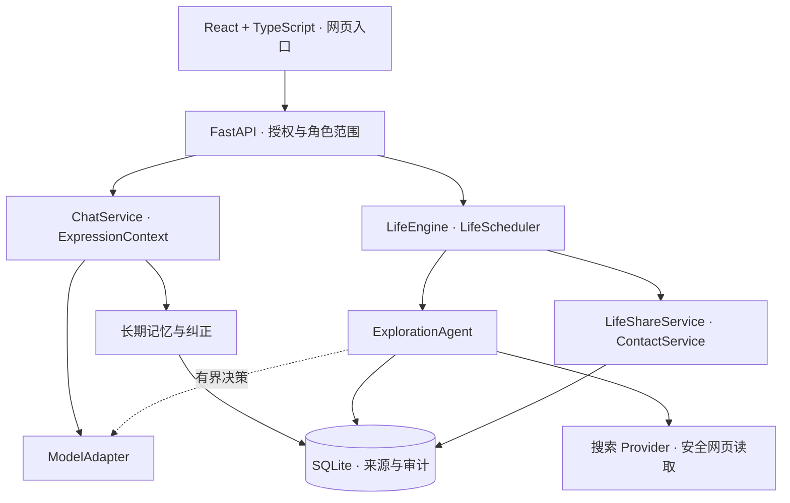

**简体中文** | [English](README_EN.md)

# Soulseed

**让每个人都能创造属于自己的、持续成长的数字个体。**

**A World for Every Individual.** [产品愿景与决策档案](docs/product_vision.md)记录了已确认的长期方向。

[](CHANGELOG.md)
[](docs/setup.md)

Soulseed 正在构建承载不同数字个体的平台。长期方向是让数字个体拥有稳定的人格内核、记忆、独立判断、自主行为和持续成长能力，并在长期相处中形成独特的关系与互动习惯。角色创作、多角色相互交流和持续发展的数字世界属于未来方向，当前应用尚未交付这些能力。

**大肥鱼是第一个验证角色。** 当前应用是围绕她构建的本地单用户原型；角色创建、角色选择和多用户服务仍属于后续规划。

[能力与进度](#能力与进度) · [技术架构](#技术架构) · [开始使用](#开始使用) · [路线图](#路线图与限制) · [开发档案](CHANGELOG.md)

## 从一次对话到持续存在

Soulseed 把聊天视为一个数字个体持续经历的一部分。与通用 AI 助手相比，它更关注系统目标和行为背后的可追溯记录：

| 关注点 | Soulseed 的实现方向 |
| --- | --- |
| 身份延续 | 在多轮与跨会话交流中保留人格和表达边界；当前人格实现以大肥鱼为验证对象。 |
| 长期记忆 | 保存结构化记忆、来源和生命周期，通过可审计的流程澄清与纠正。 |
| 真实经历 | 区分已完成行动、计划、愿望、想象活动和中断任务。 |
| 有限自主性 | 让 Agent 从有依据的主题中选择问题，使用允许的工具，保留实际执行证据。 |
| 长期相处 | 值得分享的发现需经过联系授权、安静时段、频率限制和站内投递确认。 |

成长是这些基础能力共同支撑的方向。当前已存在的规则式偏好更新只是初步机制，完整的人格与成长引擎仍在规划中。

## 能力与进度

**2.8.0 仍在开发中。** 代码实现、隔离自动测试与真实运行验收是三个不同的里程碑。以下状态核查于 2026-11-09。

| 模块 | 已实现的能力 | 验证状态与边界 |
| --- | --- | --- |
| 聊天与模型适配 | `ChatService`、OpenAI-compatible 适配层、有界上下文、超时处理和请求诊断 | 有自动化覆盖；默认配置为 SiliconFlow。尚未实现流式输出。 |
| 长期记忆与纠正 | 结构化存储、保守提取、确定性检索、纠正 Proposal、自然澄清、原子应用、来源与审计历史 | 已有隔离回归覆盖；当前提取与检索以规则为主，未实现语义/向量检索。 |
| 人格与初步成长 | 人格资料、`ExpressionContext`、经历/偏好边界，以及基于已完成活动的有限偏好更新 | 以首个角色验证；通用角色编辑与完整成长引擎尚未实现。 |
| **2.8.0-A · 自主探索 Agent** | 有界模型决策、真实搜索、安全网页读取、相关性判断、带来源结论和执行记录持久化 | **已确认首次手动真实成功：**“鲸鱼为什么需要唱歌？”读取 *Whale vocalization*，2 次模型决策、约 33 秒，形成 3 条来源支持的结论并保留科学不确定性。这是一个成功案例，尚未覆盖全部主题。 |
| **2.8.0-B · 后台自主探索** | 复用 `LifeScheduler`，依据保存的选题候选，支持 24/48/168 小时间隔、暂停、冷却、额度及重启恢复 | 已通过隔离验收，并完成一次真实无人操作后台探索；此次选题来自已保存的未解决问题，尚未验证独立产生全新兴趣。 |
| **2.8.0-C · 探索成果主动分享** | 发现筛选、角色范围内的来源、去重、联系规则，以及待分享 → 待展示 → 投递 → 已读流程 | 已验证手动研究成果的真实主动消息投递与来源追问，已读状态尚未确认。本次后台探索的分享与联系意图仍为 pending，尚未验证新消息生成和投递。 |
| **2.8.0-D · 探索额度** | 独立 UTC 每日请求预留、额度快照、启动预检查及供应商/网络错误区分 | 有隔离覆盖；默认每日 8 次探索请求预留，不是货币消费上限。 |
| 角色归属与数据隔离 | 本地配对会话、角色范围仓储和防止跨角色引用的数据库约束 | 有隔离覆盖；固定 Development 模式仅面向本机单用户与 `big_fish`，尚非多用户部署系统。 |

B/C 的修复与补充测试已归档；模型式联系生成需显式开启，本地安全生成器会保留探索分享为 pending。[CHANGELOG](CHANGELOG.md) 保留各历史检查点及其证据边界。

## 技术架构



模型提出行动，服务端校验工具权限和参数，服务与仓储负责持久化。网页内容按不可信资料处理；公网目标限制、DNS/重定向检查、TLS 验证及大小/时间上限共同约束读取。规则生成的虚拟生活活动不能充当真实网络探索的证据。

**主要技术栈：** Python 3.11+、FastAPI、Pydantic、HTTPX、SQLite、React、TypeScript、Vite。自动化验证使用 pytest、假模型/受控工具及 Node 内置测试运行器。

## 开始使用

当前主要开发流程为 Windows PowerShell。准备 Python 3.11+、Node.js 20+ 与 npm，以及模型服务配置。前端测试直接导入 TypeScript，需要 Node.js 22.18+ 或 24+，详见[完整指南](docs/setup.md)。

```powershell
git clone https://github.com/KaoruMiyagawa/Soulseed.git
Set-Location Soulseed
python -m venv .venv
.\.venv\Scripts\python.exe -m pip install -r backend\requirements.txt
if (-not (Test-Path -LiteralPath .env)) { Copy-Item .env.example .env }
npm --prefix frontend install
```

已有 `.env` 时请保留原文件。在被 Git 忽略的 `.env` 中填写 `SOULSEED_MODEL_API_KEY`，然后先以关闭模型的方式查看应用：

```powershell
powershell -NoProfile -ExecutionPolicy Bypass -File .\start-development.ps1 --model-off
```

打开 **[127.0.0.1:5174](http://127.0.0.1:5174/)**，API 位于 **[127.0.0.1:8001](http://127.0.0.1:8001/api/health)**。启动器使用持久化 Development 数据库；目前即使使用 `--model-off` 也要求配置 Key，但启动过程不调用模型。省略 `--model-off` 会启用模型，可能产生供应商费用。后台自主探索默认关闭。

配置、本地配对模式、备份迁移保护、前端测试和排障见 **[安装、运行与维护](docs/setup.md)**；启动器的精确行为见 [Development runtime](docs/development_runtime.md)。

```powershell
# 隔离后端回归：临时数据库、假模型与受控工具结果
.\.venv\Scripts\python.exe backend\scripts\run_isolated.py tests

# TypeScript 检查与前端构建
npm --prefix frontend run build
```

## 项目结构

```text
backend/
  app/          聊天、人格、记忆、生活、探索、联系与仓储
    memory/     提取、检索、Proposal、纠正与澄清
  scripts/      Development 与隔离测试启动器
  tests/        临时库回归与受控 fixture
frontend/
  src/          React 界面、请求与投递处理
  tests/        网络传输、额度和主动消息投递测试
docs/           安装、运行、归属与诊断文档
CHANGELOG.md    详细技术历史与验证边界
```

## 路线图与限制

- **近期验收：** 后台探索成果的主动消息生成与投递、独立产生新兴趣，以及更多检索主题与失败场景。
- **角色创造：** 可配置人物资料、角色创建与选择界面、角色资产管理。
- **持续成长：** 更丰富且有依据、可纠正、允许变化的兴趣、习惯与成长机制。
- **后续基础设施：** 扩展身份提供方与多用户授权，增加交互通道、流式输出和更好的检索能力。

当前系统面向本机运行，一个 SQLite 数据库只支持一个后端进程；不支持公网多用户部署、多 worker 共享数据库或外部主动推送。后台行动需要后端保持运行。搜索服务的可用性和相关性受网络与供应商影响，成功读取网页本身不足以完成研究。模型上下文 Token 计数使用保守估算，尚非供应商原生 tokenizer。

## 大肥鱼：第一个验证角色

大肥鱼淘气、活泼、好奇，保留童真。她为人格连续性、记忆纠正、诚实的经历表达、探索和分享提供了具体的验证对象。当前人格与视觉资源服务于这一验证，Soulseed 的长期范围包含许多不同的数字个体。

可阅读[当前人格资料](backend/app/persona_profile.md)与[人工验收场景](docs/persona_test_cases.md)。

## 参与贡献

Soulseed 处于 MVP 持续开发阶段。欢迎通过 [Issues](https://github.com/KaoruMiyagawa/Soulseed/issues) 和 Pull Request 提交可复现的问题、文档改进或范围明确的小改动。请说明观察结果、预期行为，以及验证使用的是假模型还是真实供应商。

测试使用隔离数据库；贡献内容不应包含密钥、私人对话、数据库、SQLite sidecar、日志、备份或未授权资产。涉及归属、迁移、记忆语义或后台模型开销的变更，先讨论设计与边界。

继续阅读：[安装指南](docs/setup.md) · [运行环境](docs/development_runtime.md) · [角色归属与本地认证](docs/ownership_and_local_auth.md) · [探索诊断](docs/exploration_action_diagnostics.md) · [技术版本档案](CHANGELOG.md)。
