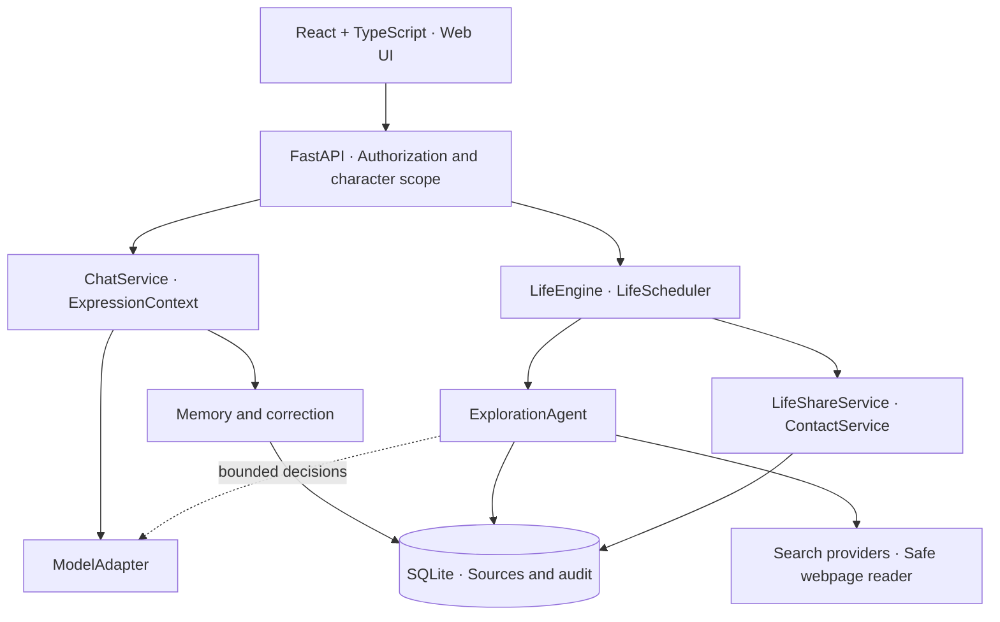

[简体中文](README.md) | **English**

# Soulseed

**A future where everyone can create a digital individual of their own—one that keeps growing.**

[](CHANGELOG.md)
[](docs/setup_EN.md)

Soulseed is building a foundation for different digital individuals: persistent characters with their own personality, memories, experiences, interests, and history. The vision is for people to create or choose a character, then develop a unique relationship through long-term interaction and growth.

**Da Feiyu (大肥鱼, “Big Fish”) is the first validation character.** The current application is a local, single-user prototype centered on her. Character creation, character selection, and a multi-user service are future work.

[Capabilities](#capabilities-and-status) · [Architecture](#architecture) · [Get started](#get-started) · [Roadmap](#roadmap-and-limitations) · [Development history](CHANGELOG.md)

## From conversation to a continuing individual

Soulseed treats a conversation as one part of a character's ongoing history. Its distinction from a general-purpose assistant lies in the system's goals and the records behind its behavior:

| Focus | Soulseed's approach |
| --- | --- |
| Identity | Preserve personality and expression boundaries across conversations. The current persona implementation validates Da Feiyu. |
| Memory | Store structured memories with sources, lifecycle states, and an auditable correction process. |
| Experience | Distinguish completed actions, plans, wishes, imagined activities, and interrupted tasks. |
| Agency | Let a bounded Agent select a supported topic, use approved tools, and retain evidence of what it actually did. |
| Relationship | Share worthwhile discoveries through contact permissions, quiet hours, frequency limits, and confirmed in-app delivery. |

Growth is a direction supported by these foundations. The current rule-based preference updates are an early mechanism, not a complete personality or growth engine.

## Capabilities and status

**2.8.0 is in development.** Implementation, isolated automated tests, and live acceptance are separate milestones. Status reviewed on 2026-11-09.

| Area | Implemented | Verification and boundaries |
| --- | --- | --- |
| Chat and model integration | `ChatService`, an OpenAI-compatible adapter, bounded context assembly, timeouts, and request diagnostics | Automated coverage; the default configured provider is SiliconFlow. Streaming is not implemented. |
| Long-term memory and correction | Structured storage, conservative extraction, deterministic retrieval, correction proposals, clarification, atomic application, sources, and audit history | Isolated regression coverage. Extraction and retrieval use rules; semantic/vector retrieval is not implemented. |
| Personality and early growth | Persona profile, `ExpressionContext`, experience/preference boundaries, and limited updates from completed activities | Validated with the first character; general character authoring and a complete growth engine remain future work. |
| **2.8.0-A · Exploration** | Bounded model decisions, real search, safe webpage reading, relevance checks, source-backed claims, and persistent execution records | **First live manual success confirmed:** “Why do whales need to sing?” Read *Whale vocalization*, produced three sourced claims with scientific uncertainty, and completed in about 33 seconds with two model decisions. This is one successful case, not broad topic validation. |
| **2.8.0-B · Background exploration** | Opt-in scheduling through `LifeScheduler`, saved-topic candidates, 24/48/168-hour intervals, pause/cooldown, quotas, and restart recovery | Isolated acceptance passed, followed by one successful unattended live run. Its topic came from a saved unresolved question; independently generating a new interest remains unverified. |
| **2.8.0-C · Discovery sharing** | Worthwhile-result selection, character-scoped sources, deduplication, contact rules, and pending → ready → delivered → read handling | Live delivery and a source follow-up were verified for the manual research result; its read status remains unconfirmed. The new autonomous run's share and contact intents remain pending, and message generation and delivery are not yet verified. |
| **2.8.0-D · Exploration quota** | Separate UTC daily request reservations, quota snapshots, prechecks, and distinct provider/network errors | Isolated coverage. The default exploration limit is eight reservations per UTC day; it is not a monetary spending cap. |
| Ownership and isolation | Local pairing sessions, character-scoped repositories, and database constraints against cross-character references | Isolated coverage. Fixed Development mode is limited to one local user and `big_fish`; this is not a multi-user deployment system. |

The B/C fixes and supplementary tests have been archived. Model-based contact generation is opt-in; the local safe generator keeps research shares pending. The [changelog](CHANGELOG.md) preserves historical checkpoints and their evidence.

## Architecture



The server validates model-proposed actions and tool arguments. Persistence stays in services and repositories. Web content is untrusted input; public-target validation, DNS/redirect checks, TLS verification, and size/time bounds constrain access. Rule-generated virtual activities do not count as evidence of real web exploration.

**Stack:** Python 3.11+, FastAPI, Pydantic, HTTPX, SQLite, React, TypeScript, and Vite. Automated checks use pytest, fake models/controlled tools, and Node's test runner.

## Get started

The primary development workflow is Windows PowerShell. Use Python 3.11+, Node.js 20+ with npm, and a configured model provider. Frontend tests import TypeScript directly and require Node.js 22.18+ or 24+; see the [setup guide](docs/setup_EN.md).

```powershell
git clone https://github.com/KaoruMiyagawa/Soulseed.git
Set-Location Soulseed
python -m venv .venv
.\.venv\Scripts\python.exe -m pip install -r backend\requirements.txt
if (-not (Test-Path -LiteralPath .env)) { Copy-Item .env.example .env }
npm --prefix frontend install
```

Preserve any existing `.env` instead of copying over it. Set `SOULSEED_MODEL_API_KEY` in that ignored file, then start in model-disabled mode to inspect the application:

```powershell
powershell -NoProfile -ExecutionPolicy Bypass -File .\start-development.ps1 --model-off
```

Open **[127.0.0.1:5174](http://127.0.0.1:5174/)**; the API runs on **[127.0.0.1:8001](http://127.0.0.1:8001/api/health)**. This launcher uses a persistent Development database, requires a configured key even with `--model-off`, and makes no model request at startup. Omit `--model-off` to enable model use; provider charges may apply. Background exploration starts disabled.

For configuration, pairing mode, backup/migration protection, frontend tests, and troubleshooting, use the **[setup and operations guide](docs/setup_EN.md)**. The launcher’s exact behavior is documented in [Development runtime](docs/development_runtime.md).

```powershell
# Isolated backend regression; temporary databases and controlled model/tool results
.\.venv\Scripts\python.exe backend\scripts\run_isolated.py tests

# TypeScript checking and production frontend build
npm --prefix frontend run build
```

## Project layout

```text
backend/
  app/          Chat, persona, memory, life, exploration, contact, and repositories
    memory/     Extraction, retrieval, proposals, correction, and clarification
  scripts/      Development and isolated-test launchers
  tests/        Temporary-database regressions and controlled fixtures
frontend/
  src/          React UI and request/delivery handling
  tests/        Transport, quota, and proactive-delivery tests
docs/           Setup, runtime, ownership, and diagnostics
CHANGELOG.md    Detailed technical history and verification boundaries
```

## Roadmap and limitations

- **Next validation:** message generation and delivery for autonomous discoveries, independently generated new interests, and a wider range of search topics and failure conditions.
- **Character creation:** configurable character profiles, creation/selection interfaces, and character asset management.
- **Growth:** richer interests, habits, and development that remain attributable, correctable, and capable of change.
- **Later infrastructure:** broader identity providers and multi-user authorization, additional interaction channels, streaming, and improved retrieval.

The current system runs locally with one backend process per SQLite database. It does not support public multi-user hosting, shared multi-worker databases, or external push notifications. Background activity requires a running backend. Search availability and relevance vary by network and provider; successful page retrieval alone cannot complete a research task. Model-context token counts are conservative estimates rather than the provider's tokenizer.

## Da Feiyu: the first validation character

Da Feiyu is playful, lively, curious, and childlike. She gives the project a concrete way to evaluate personality continuity, memory correction, honest accounts of experience, exploration, and sharing. Her persona and artwork support that validation; Soulseed's long-term scope includes many different individuals.

See the [current persona profile](backend/app/persona_profile.md) and [manual review scenarios](docs/persona_test_cases.md), both currently in Chinese.

## Contributing

Soulseed is an evolving MVP. Focused bug reports, reproducible cases, documentation improvements, and small, well-scoped changes are welcome through [Issues](https://github.com/KaoruMiyagawa/Soulseed/issues) and pull requests. Describe what was observed, what was expected, and whether verification used fake models or a live provider.

Use isolated databases for tests. Keep credentials, conversations, databases, SQLite sidecars, logs, backups, and unapproved assets out of contributions. Discuss changes to ownership, migrations, memory semantics, or background model spending before implementation.

Further reading: [setup](docs/setup_EN.md) · [runtime](docs/development_runtime.md) · [ownership and local authentication](docs/ownership_and_local_auth.md) (Chinese) · [exploration diagnostics](docs/exploration_action_diagnostics.md) · [changelog](CHANGELOG.md) (Chinese).
