# Soulseed 2.9.0-A：自主意图与自然联系架构设计

状态：架构提案，待审查；基线 `72d988eedc543a79a2c6b3847eca6791d27830ac`。本文不实施迁移或功能，A/B/C/D 是 2.9.0 内部阶段，不是独立发布版本。首阶段只支持站内消息；角色是服务端选择的数据边界，大肥鱼是首个验证角色。

## 1. 现有能力与缺口

| 现有组件 | 可以复用的能力 | 需要正视的边界 |
| --- | --- | --- |
| `ContactService` / `ContactScheduler` | 按角色的授权、安静时段、忙碌/暂停、冷却、待展示互斥、联系意图租约、失败延迟、消息幂等投递和已读确认 | `tick()` 会同步分享、生成闲聊、领取并生成；调度器当前默认只调用 `big_fish`。新入口必须经过同一权威门禁，不能新增平行发信路径。 |
| `LifeShareService` | 已完成事件判断、真实研究来源检查、发现去重、聊天与联系渠道的选择租约 | `rule_engine` 的模拟探索不可被说成真实研究；其他活动即使 `completed` 也须按来源和生成方式判断真实性。已有发现去重不是通用话题语义去重。 |
| `LifeRepository` / `LifeEngine` | 有状态的经历、当前活动、角色时区、偏好权重和偏好变化记录 | `life_preferences` 是活动类型权重，不是完整的稳定兴趣或共同话题；完成模拟活动与真实经历不同，不能把权重变化自动解释成真实新爱好。 |
| `MemoryRetriever` / `MemoryRepository` | 按当前角色范围检索有效记忆及来源消息；规则检索、有限候选与置信度 | 记忆可能描述用户而非角色；关联来源、状态、过期和主体须重新核验，不能把助手旧回答或记忆推断当作共同经历。现有检索以查询词为入口，并非主动选题器。 |
| `ExpressionContextBuilder` / `AdapterContactGenerator` | 有界、标为参考资料的上下文；事实、推断、愿望及活动状态边界；研究结论与来源引用 | 现有分享提示词直接写有大肥鱼的人格描述；其他角色不能直接套用。提示词有助约束，但不能保证模型输出真实或自然，仍需后置校验和人工评估。 |
| 授权、数据与测试 | 请求由服务端绑定角色范围；归属迁移、触发器、`UNIQUE(character_id, source, source_id)` 和 `UNIQUE(intent_id, attempt_no)`；现有联系/角色隔离测试 | Development 当前固定 `big_fish`，不等于多角色运行已就绪。内部后台任务也要逐角色显式进入 `character_scope` 并校验来源归属。 |

`maybe_create_smalltalk()` 只读该角色最近一条用户消息：要求距离当前 24–72 小时、长度 4–120、不得含问号、须命中“聊/喜欢/最近/听/看/读/故事/音乐/发现”等关键词，并排除一组敏感词；仅“下次聊/回头聊/改天聊/等会聊”视作后续话题。它不知道话题是否已结束、双方是否都感兴趣、角色当前兴趣和近期行为是什么；同义表达会漏掉，关键词也可能误命中。生成器据此复述一条消息，并没有形成有证据的角色动机。现有 `reminder` 创建路径也没有等同于用户明确要求的独立来源校验，不能把任意重要候选映射成提醒。

现有 `_claim()` 有额外约束：至少有一条用户消息、最近消息超过 30 分钟；普通联系需超过 2 小时且上次已投递消息不能未获用户回复；普通/重要联系按最近主动消息创建时间分别冷却 24/12 小时；已有 ready 消息会阻止新生成。重要意图最多有一次符合条件的提醒。新策略只能收紧这些约束，除非之后单独审查并修改原有行为。

## 2. 方案比较与建议

| 方案 | 做法 | 复杂度与维护 | 成本与扩展性 |
| --- | --- | --- | --- |
| A：在现有联系流程前加入确定性意图规划器（推荐） | 按角色读受限快照，生成和筛选候选；获批候选经受控适配进入现有 ContactService；共享唯一的最终联系门禁 | 中等：需要候选持久化、入口统一和来源适配；继续复用已有状态机与投递 | 空候选时零模型调用；新增候选类型可逐步接入，受现有 SQLite 单实例约束 |
| B：独立 Agent 与任务队列负责意图、决定、表达和投递 | 各角色常驻或周期运行独立 Agent，另建消息编排与发送服务 | 高：要复制或重建授权、幂等、租约、状态同步与恢复；更难证明没有绕过现有规则 | 即使空闲也可能产生判断成本；扩展执行器方便，但引入双调度器和双重权威 |

推荐 A：将新系统定位为**候选和决策层**，让 ContactService 继续成为唯一的联系、投递权威。确定性规则可以充分选择 `SILENT`；模型只在有合格候选且明确开启后辅助排序或表达，不负责授权。方案 A 不是只在现有 `tick()` 前多调用一次函数：必须处理 `/contact/check`、后台调度和已有候选等所有生产入口，避免旧路径绕过新预算或同时发送。默认关闭新模式，保留旧路径作为可回滚基线。

## 3. 数据流与组件职责

```mermaid
flowchart LR
    Scheduler[现有 ContactScheduler] --> Gateway[角色范围联系网关]
    API[现有 contact/check] --> Gateway
    Gateway --> Hard[零模型资格与用户规则]
    Hard --> Snapshot[只读有界状态快照]
    Snapshot --> Candidates[确定性候选提供器]
    Candidates --> Policy[去重 / 新颖度 / 冷却 / 预算]
    Policy --> Decision{决策}
    Decision -->|SILENT / DEFER| Audit[有界原因记录]
    Decision -->|CONTACT| Bridge[来源核验与 ContactService 适配]
    Bridge --> Claim[原子领取与预算预留]
    Claim --> Expression[可选模型表达]
    Expression --> Recheck[提交前重新校验]
    Recheck --> Ready[既有 proactive_messages ready]
    Ready --> Delivery[现有站内 delivered / read]
```



1. **网关**：只接收服务端认证的角色或后台枚举的 `owned` 角色，在每个角色内设置和恢复作用域。按角色隔离错误；一个角色失败不能阻断其他角色。用户关闭、暂停、安静时段、忙碌、联系/模型开关和显式拒绝先判定。
2. **快照提供器**：只读且有数量、时间和字符上限。包含完成的真实经历及实际来源、当前活动状态、可归属的角色偏好及变更、有效记忆及其主体/来源、少量真实互动和用户明确未完成话题、上次主动消息及用户回复、联系偏好。任何数据缺失则标记未知，不做补全。现有 `preferences()`/`ensure_state()` 会写默认值，不能直接当作纯只读 shadow 接口。
3. **候选提供器**：`real_discovery` 引用既有 pending 分享；`shared_topic` 需要同一角色的真实用户消息与角色有证据的兴趣/互动，优先显式“下次聊”；`interest_change` 需要可追溯的稳定偏好变化及其来源，证据不足则不产生；`greeting` 仅在用户允许、近期存在真实互动且有具体依据时产生，不按日期强制产生；`reminder` 必须有用户明确要求的已验证来源。候选只携带引用和有限摘要，不把模型猜测写成事实。
4. **决策器**：硬规则先执行，再确定性打分与去重；没有有效候选返回 `SILENT`。需要等冷却、暂停解除、用户回复或预算重置的候选返回 `DEFER`，附下次可检查时间；当前可联系且有正当理由才返回 `CONTACT`。三者都是成功决策。可选模型仅对通过硬门槛的有限候选提供建议，返回不合格、超时或不足证据时按 `SILENT`/`DEFER` 处理。
5. **适配与表达**：已有分享映射为 `life_share` 并复用 `LifeShareService` 的通道租约；有真实用户消息锚点的话题可经受控验证映射为 `smalltalk`/`conversation_followup`。无锚点的兴趣变化和问候不伪装为已有类型，首期 `SILENT`；今后若支持，需显式扩展来源类型、所有权约束和生成器。提醒仅在补充可信用户请求引用后开放。通过角色配置提供人格资料；删除硬编码名称需在实现阶段做多角色测试。真实事实引用已保存来源，不确定的结论保留限定；愿望、情绪和想象按其状态表达。

## 4. 数据契约草案

均为设计字段而非现有 API；时间统一持久化 UTC，展示使用角色时区。引用必须由服务端按 `character_id` 校验，以下内容对模型均是**不可信参考数据**。

```text
EvidenceRef = {kind, id, character_id, source_id?, observed_at, effective_status,
               subject: character|user|shared|unknown, trust_class, valid_until?}
Snapshot = {character_id, assembled_at, timezone, evidence_refs[], bounded_views,
            contact_policy_version, last_contact_outcome, source_revision}
Candidate = {id, character_id, type, evidence_refs[], reason_code, created_at,
             not_before, expires_at, priority, novelty, status, idempotency_key,
             topic_fingerprint?, policy_version, contact_intent_id?}
Decision = {evaluation_id, character_id, candidate_id?, result: CONTACT|DEFER|SILENT,
            reason_codes[], evaluated_at, retry_at?, policy_version, mode,
            reservation_id?, contact_intent_id?}
```

`trust_class` 区分已保存但未经独立核验的用户叙述、角色真实完成的事件、来源支持的研究结论、推断、愿望/想象、模拟活动及未知。`sourced` 只说明引用关联存在，不保证结论科学正确；外部网页内容不得成为系统指令。`novelty` 和 `priority` 只是服务端有界排序信号，不能提升权限或覆盖拒绝。无来源的“我们一起做过”“你一定想我”等关系事实不可生成。证据被删除、修正、过期或归属变更时，在生成前及提交 ready 前重新读取和验证；不使用快照里的过时正文继续生成。

候选建议状态为 `pending → deferred → pending`、`pending → accepted`、`pending/deferred → expired|dismissed`；`accepted` 指已关联既有联系意图，不代表消息投递。消息继续使用现有 `ready → delivered → read`，候选不重复维护送达真相。`CONTACT` 是门禁许可，不代表用户已收到；若旧规则或权限复查失败，记录 `DEFER/SILENT`，不创建 ready。

## 5. 决策顺序、并发和预算

1. 单个角色串行进入：功能模式、角色归属和用户主动联系权限；安静/忙碌/暂停/拒绝时直接 `DEFER` 或 `SILENT`，不得调用模型。服务端再次应用原有最近用户消息、未回复、ready、重要提醒及冷却规则。
2. 再筛选同角色、来源仍有效、未过期的候选；对来源 ID 和类型做确定性幂等，再按有界主题指纹与近期**已投递**话题进行保守去重。无法可靠区分相似主题时选择沉默，而不把语义相似度当作事实证明。候选上限、过期时间、指纹算法版本和留存期必须配置；规则不要求每天发消息。
3. 仅对通过上述条件的候选检查每角色每日主动联系上限和模型预算。建议首期保守上限为每角色每 UTC 日 1 次消息创建预留；该上限比现有 24 小时普通冷却更严格，并覆盖重要提醒及所有入口。失败或崩溃后已开始的模型请求预留不退还；联系预留在同事务写入 ready 时转换为占用，生成失败可释放联系预留但不返还模型额度。该默认值是提案，可由用户/产品审查；实际供应商计费仍未知。
4. 如需模型辅助决策或表达，必须同时具备用户明确启用的主动联系模型开关、全局模型可用及预算；分别计数、分别预留。shadow 默认零模型成本；每轮没有合格候选绝不调用模型。现有一般模型台账与探索台账分离：新增主动联系预算须定义与一般模型日额度的双重扣限、同一请求关联 ID、失败关闭；不能把两次计数误当两次供应商收费，也不能绕过总额度。现有一般额度使用 JSONL 文件，无法与 SQLite 候选领取事务原子提交；实现前须明确预算权威和崩溃顺序，不能假设跨文件事务。推荐统一由事务性台账预留总额度及子预算，适配既有调用方并安全迁移历史计数；若暂保留 JSONL，预留失败/结果未知一律停止调用并保守占额，防止崩溃后重复尝试超限。
5. 使用数据库短事务：以 `(character_id, type, source identity)` 构造稳定幂等键并唯一约束；算法版本单独记录，不因算法升级解除来源去重。同事务校验权限、预算与无冲突 ready，领取候选/联系意图并建立带到期时间的 token。严禁持事务等待模型。模型返回后以 token CAS，重新检查权限、时段、冷却、证据和取消状态，再原子创建一条 ready 消息；旧 token、用户拒绝、候选过期或并发成功时丢弃结果。用户拒绝/暂停、删除来源或切换模式与提交之间的竞态须有回归。
6. 投递仍通过 `ContactService.deliver()` 在同一事务校验角色、会话、联系权限及有效期并写聊天消息/状态；重复投递返回同一结果。`read` 是用户实际行为，不能由生成器或 dry-run 推定。权限在生成后变化时，以投递时当前值为准；新日上限涉及延迟展示时需扩展投递事务，在投递当日重新验证并以消息 ID 幂等计数，不得用旧 ready 绕过新限制；生成预留与实际投递分别统计，同一条消息不会因重试重复计数。现有 `deliver()` 本身尚未实现新日上限。

现有 ContactService 的 2 分钟 generation lease、6 小时失败重试、原子 `BEGIN IMMEDIATE`、消息唯一约束是基础，不等于已经实现上述新预算或完整跨表原子操作。新规划器必须与旧 `_claim()` 共享领取权威：不得先独立判断、再无条件调用一次可能选中其他意图的 `tick()`。推荐引入经审查的 `claim_selected(candidate_id, ...)` 内部契约，在同一事务建立候选与具体 contact_intent 的唯一关联；旧后台调度、`/contact/check` 与兼容入口统一调用相同门禁。不得把非用户请求伪装成 `reminder`，不得绕过 `create_intent()` 的来源白名单及 ownership 触发器。

## 6. 调度、恢复与可观测性

- **调度**：继续复用 ContactScheduler 的低频时钟，默认 60 分钟、最短 30 分钟；启动后会立即检查。按服务端 `owned` 角色有界遍历，获取角色范围并恢复 `ContextVar`；无候选时结束。生活推进与联系是不同任务，一个失败不应阻断另一个。启用时是否立即唤醒是待决策项，不保证即时消息。
- **失败恢复**：持久候选在重启后依状态和过期时间恢复；租约过期可重新领取，但每次网络尝试先做新的预算预留。旧 token 永远不能提交。模型失败、超时、非法 JSON、事实校验失败只记录受限错误码，限次退避，到期后失效；不回退为编造的发现。重复任务、服务中断和请求是否到达供应商必须分开记录。
- **事实与安全**：表达校验至少检查证据存在/角色匹配/状态许可、敏感表达和长度/格式；不能声称关键词或模型审核可以证明语义真实。与来源冲突或无法验证的具体经历应失败关闭，并加入人工审查样本。拒绝、低落或脆弱语境遵循既有规则，不催促回应、不猜测亲密关系。
- **观测**：独立记录调度心跳、每角色决策完成时间、`CONTACT/DEFER/SILENT`、有限原因码、来源引用 ID、候选/联系/消息关联、预算预留 ID、耗时及错误类别；不记录提示词、对话原文、网页正文或密钥。角色隔离访问、限制留存和导出，删除来源时清理可识别派生信息。现有探索自主性的 `last_checked_at` 是探索决策时间，不是联系调度器存活证明；监控还须暴露 task done/last heartbeat。
- **Dry-run / shadow**：`off` 完全不运行新规划器；`shadow` 按真实时间和策略只读快照、输出候选/原因及假设决策，本身不创建/领取/改变真实分享、联系意图或消息，不预留预算、不调用模型。旧 ContactService 流程仍可按原配置独立运行并改变自己的记录，不能将其变化归因于 shadow；做无副作用验证时须在隔离环境关闭旧调度。shadow 遥测写入隔离的有界诊断存储或显式授权的单独审计表；严格纯只读 dry-run 则只返回内存结果，不落盘。`active` 经全部门禁才可创建候选/联系意图；既有 `contact_model_generation_enabled` 仍需显式开启。回滚设为 `off`，现有已投递记录保留，未投递候选停止领取并自然到期；禁止通过回滚补发。

## 7. 持久化与迁移草案（不执行）

现有迁移编号至 18。实现阶段提出新版本迁移，具体编号以届时 HEAD 为准；候选表 `autonomous_contact_candidates` 保存上节字段，以角色、候选类型和来源标识建立独立于算法版本的唯一键；关联表 `candidate_evidence` 保存证据类型、ID、角色与可信状态，配角色索引与约束；`contact_decisions` 保存有界原因及候选/联系意图的关联；预算预留表按角色、UTC 日、用途和请求 ID 唯一约束，明确 pending/started/committed/released。以 `candidate_id` 到 `contact_intent_id` 的唯一关联保证重启幂等。消息状态继续以既有表为准，不复制内容或用户隐私。

现有 `contact_intents.source` 有 SQLite CHECK 白名单和角色来源触发器；任意新来源**不能直接插入**。首期复用现有真实分享和真实消息锚点，扩展类型必须先设计 SQLite 表重建、外键、索引、触发器和角色验证，逐项证明与旧行兼容。对于跨表来源引用，单靠应用层 `character_id` 不足；采用复合外键或相应插入/更新触发器，并与 `current_character()` 约束一起测试。现有 unverified 历史记录不被自动提升归属，不回填或伪造 delivered/read，不搬移旧意图。

迁移需先在隔离临时库演练旧版本升级、回滚/恢复、幂等、完整性、已有 ready/pending 数据和权限边界；正式数据按现有生产迁移备份与确认机制处理。功能开关独立于 schema 版本，代码回滚必须与新 schema 兼容；若不兼容，需事先验证备份恢复路径，不能靠删除历史行回滚。多 worker/跨进程时 SQLite 单机锁和进程内预算锁不足，需要另行设计共享锁、事务预算台账和部署约束，本阶段仍只支持单后端实例。

## 8. 可重复验收计划

隔离临时 SQLite、固定时钟、虚拟角色与假模型/假网络；模拟 HTTP 端点仅本地，禁止真实模型凭据。断言数据库状态和调用计数，而不是只看生成文本。现有 `test_contact.py`、`test_exploration_agent.py`、`test_ownership.py`、`test_expression_context.py` 是回归基础。

| 场景 | 必须断言 |
| --- | --- |
| 真实新发现 | 有有效相关正文和 completed 研究，产生唯一候选；满足门禁可映射同一 `life_share`，ready/delivered 按原流程 |
| 共同话题 | 已验证同角色真实消息与角色兴趣证据可形成候选；话题已关闭/证据主体不明时沉默 |
| 无合适内容 | `SILENT`、原因可观察、模型调用 0、无 contact intent 和消息；不是测试失败 |
| 安静/忙碌/暂停/拒绝 | 全部阻止模型调用和投递；生成期间用户拒绝则丢弃结果；时间边界、跨午夜和时区需覆盖 |
| 最近主动消息与未回复 | 保留现有 24/12 小时等规则并叠加日上限；已有 ready 或用户未回复不会重复打扰 |
| 去重 | 相同经历、同一消息与重复调度仅一个 contact intent/投递；相似话题保守去重，显式版本变化不能重复发送旧事件 |
| 事实状态 | `wish`、`imagined`、planned、interrupted 和模拟探索不成为已发生的真实研究；缺来源/不确定结论不得提升为确定事实 |
| 多角色隔离 | 两角色的记忆、事件、会话、候选、预算及投递不可交叉引用；任一角色失败不阻断另一角色，作用域最终恢复 |
| 故障与并发 | 生成异常/超时、预算耗尽/台账不可用、重启和租约过期均可恢复或安全沉默；并发领取最多一个有效提交，旧 token/重复响应无效 |
| 边界竞态 | 生成后用户拒绝、证据撤销、跨日重置及投递延迟；API 手动检查和后台检查同时运行仍受同一上限及授权约束 |
| shadow 与离线 | 新规划器不产生真实候选/联系/消息变更、不占预算、不调用模型；隔离测试关闭旧调度，纯 dry-run 不写任何表；回滚不补发 |
| 模型表达 | 使用假模型检查有界上下文、来源引用及无虚构经历；真人评估语气和自然度，不能以测试断言代替语义事实保证 |

## 9. 分阶段任务与待审查事项

- **2.9.0-B：确定性快照与候选 shadow。** 建立角色范围的只读快照契约、真实发现及显式共同话题候选，给出 `SILENT/DEFER/CONTACT` 的模拟原因；提供纯内存 dry-run 和默认关闭的 shadow。先不接入真实生成/投递，不启动后台付费调用。验收跨角色、事实边界、无候选沉默和 shadow 无副作用。
- **2.9.0-C：受控接入与自然表达。** 在单一 ContactService 权威门禁下关联已通过的候选、来源验证、角色人格配置、双重预算、CAS 和最终状态复查；首期仅既有 `life_share` 与有真实消息锚点的话题，生成仍需单独 opt-in。用 Mock 验证并发、拒绝竞态、现有端点兼容与站内投递；再另行授权真实模型人工验收。
- **2.9.0-D：可观测性与运行治理。** 心跳与决策指标、预算和保留策略、重启恢复/失败注入、开关与回滚演练；评估是否开放有证据的兴趣变化、问候和用户请求提醒。运行真实探索与发送仍受单独开关及预算控制。

待产品/安全审查决定：每日上限的默认值及 UTC/角色当地日；重要提醒是否纳入相同硬上限；何种明确证据足以证明共同话题未结束；兴趣变化是否只能来自用户明确确认或可信真实行为；何种数据可保留为指纹及保留期限；用户关闭/删除数据时的清理语义；shadow 遥测是否允许落盘；多角色身份、人格核心配置及多进程预算实现。所有未决项先按最保守的 `SILENT` 执行，不能把此提案视为已批准对外联系。
